# Documento de análisis de requisitos del sistema
**Asignatura:** Diseño y Pruebas (Grado en Ingeniería del Software, Universidad de Sevilla) 
**Curso académico:** 2026/2027 
**Grupo/Equipo:** L5-5 
**Nombre del proyecto:** Cluedo 
**Repositorio:** https://github.com/gii-is-DP1/dp1-2627-groupproject-L5-5 
**Integrantes (máx. 6):** Javier Bonilla Fernández, Amalio Romero López, David Calzado Villalba, Pedro Larios Soler, Alfonso Perea Morillo, Nicolas Martinez Adega

## Introducción

El proyecto tiene como objetivo el diseño e implementación del juego de mesa Cluedo la versión de 2012 con todas sus normas adicionales en forma digital. La aplicación permite a los usuarios crear partidas, unirse a ellas y disfrutar de una partida completa al Cluedo, garantizando el cumplimiento de las normas establecidas por el sistema.

El valor principal que nos aporta es la posibilidad de aprender y poner en práctica diferentes patrones de diseño y arquitecturas actuales. Además, gracias a la automatización del juego nos podemos olvidar de aspectos repetitivos como el reparto de cartas en cada partida, o el simple hecho de garantizar que nadie incumpla las normas.

Buscamos con su desarrollo conseguir que se pueda jugar una partida completa de principio a fin de manera fluida. Si surge un error en el backend o en la red, evitaremos que la aplicación se congele y redirigiremos a los jugadores a una página de error que les permita regresar a la partida en curso sin perder su progreso.

Además ,utilizaremos una arquitectura independiente (Spring Boot en el backend y React en el frontend), aplicando patrones de diseño en las mecánicas del juego y asegurar con pruebas unitarias y de integración que todo lo que no sea trivial funcione sin fallos. 

Las partidas están diseñadas para albergar un mínimo de 2 y un máximo de 6 jugadores. Para el modo especial de 2 jugadores, el sistema gestionará automáticamente el reparto inicial dejando 4 cartas boca abajo en el tablero que nadie posee inicialmente. Con 2 jugadores las cartas especiales no estarán habilitadas.

Comenzará a jugar el jugador que mayor número saque tirando ambos dados. La partida discurre de forma secuencial por turnos. Un jugador lanza los dados y desplaza su ficha por el tablero intentando alcanzar una habitación o una casilla de carta especial. Al entrar en una habitación, formula una sugerencia combinando un personaje, un arma y la sala actual. El sistema cede el control al resto de jugadores, en sentido horario, para que intenten refutar la teoría mostrando en secreto una carta al jugador que presentó la sugerencia. Los usuarios interactúan constantemente con una libreta de investigación integrada para registrar sus deducciones.

El juego concluye en el momento en que un participante reúne las pistas suficientes y formula una acusación final. Para ello, el jugador selecciona el trío definitivo de culpable, arma y lugar. Si las tres cartas seleccionadas coinciden exactamente con las que se escondieron en el sobre confidencial al inicio, el sistema detiene el juego, nombre a ese jugador como ganador y lo anuncia por pantalla. Si la acusación es incorrecta, el jugador queda eliminado de la investigación, por lo que no podrá volver a mover su ficha ni formular sugerencias, aunque sus cartas seguirán activas y visibles para poder refutar las preguntas del resto de jugadores.

[Enlace al vídeo de explicación de las reglas del juego / partida jugada por el grupo](https://youtu.be/_M9rlGXBljc)

## Tipos de Usuarios / Roles

**Jugador Anónimo / Invitado:** Usuario que entra a la web sin autenticarse. Solo puede ver la pantalla de inicio y una opción de registro.

**Jugador Registrado:** Usuario que ha iniciado sesión con su cuenta. Tiene permisos para crear salas de juego, unirse a las que estén abiertas, personalizar la sala si es el anfitrión y jugar la partida completa.

**Administrador:** Usuario con permisos especiales de gestión. Puede consultar y supervisar las cuentas de usuario registradas, revisar partidas activas o terminadas, gestión de logros y realizar tareas básicas de mantenimiento en la plataforma

## Historias de Usuario

A continuación se definen  todas las historias de usuario a implementar:
_Os recomentamos usar la siguiente plantilla de contenidos que usa un formato tabular:_

### Módulo 1 Juego (Preparación y Mecánicas)

### HU-001: Configuración inicial de una nueva partida ([ISSUE#39](https://github.com/gii-is-DP1/dp1-2627-groupproject-L5-5/issues/39))
Como Jugador quiero que el sistema me ofrezca un formulario para configurar una nueva partida para poder establecer el nombre de la sala y el número de participantes. 

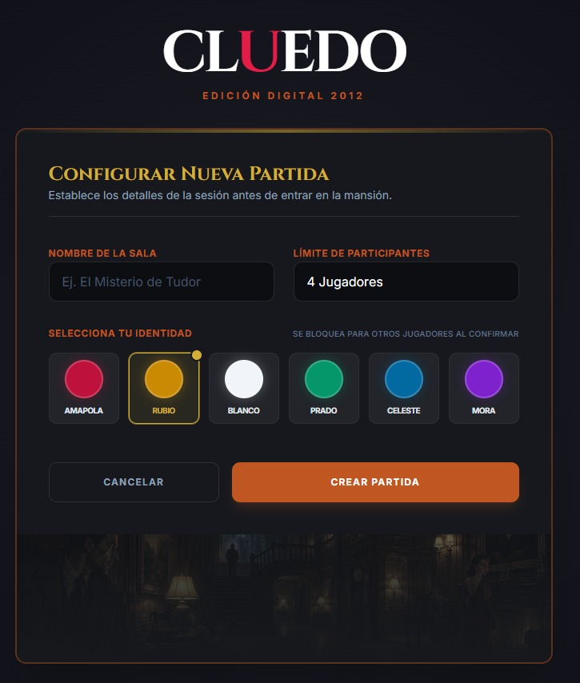

Al entrar a la opción de crear partida desde el menú principal, la aplicación muestra directamente un formulario para configurar los detalles de la sesión antes de empezar. En esta pantalla, el jugador se encontrará con una caja de texto para escribir el nombre de la sala, un desplegable para marcar el límite de jugadores (entre 2 y 6 plazas) y un pequeño panel para seleccionar su personaje (Amapola, Rubio, Blanco, Prado, Celeste o Mora). Abajo del todo, la vista incluye un botón de "Cancelar" para volver atrás y el botón principal de "Crear Partida".

El punto clave de esta pantalla está justamente al pulsar en "Crear Partida". Cuando el jugador hace clic, el frontend envía los datos al backend para comprobar que se cumplen las reglas. Por ejemplo, el servidor verifica que el nombre de la sala tenga un tamaño válido y que no esté repetido, impidiendo que haya dos partidas activas llamándose igual. Si todo es correcto, el sistema guarda la nueva sala, le asigna al creador el rol de anfitrión y bloquea el personaje que ha elegido para que nadie más pueda cogerlo. En cuanto el servidor da el visto bueno, la aplicación redirige automáticamente al usuario al Lobby de su nueva sala para que empiece a invitar o esperar a la gente.

### HU-002: Validar el acceso a una partida privada ([ISSUE#41](https://github.com/gii-is-DP1/dp1-2627-groupproject-L5-5/issues/41))
Como Jugador, quiero poder introducir el código de acceso de una partida privada para poder verificar si la sala existe y tiene huecos libres, con la opción de unirme si aún quedan huecos.

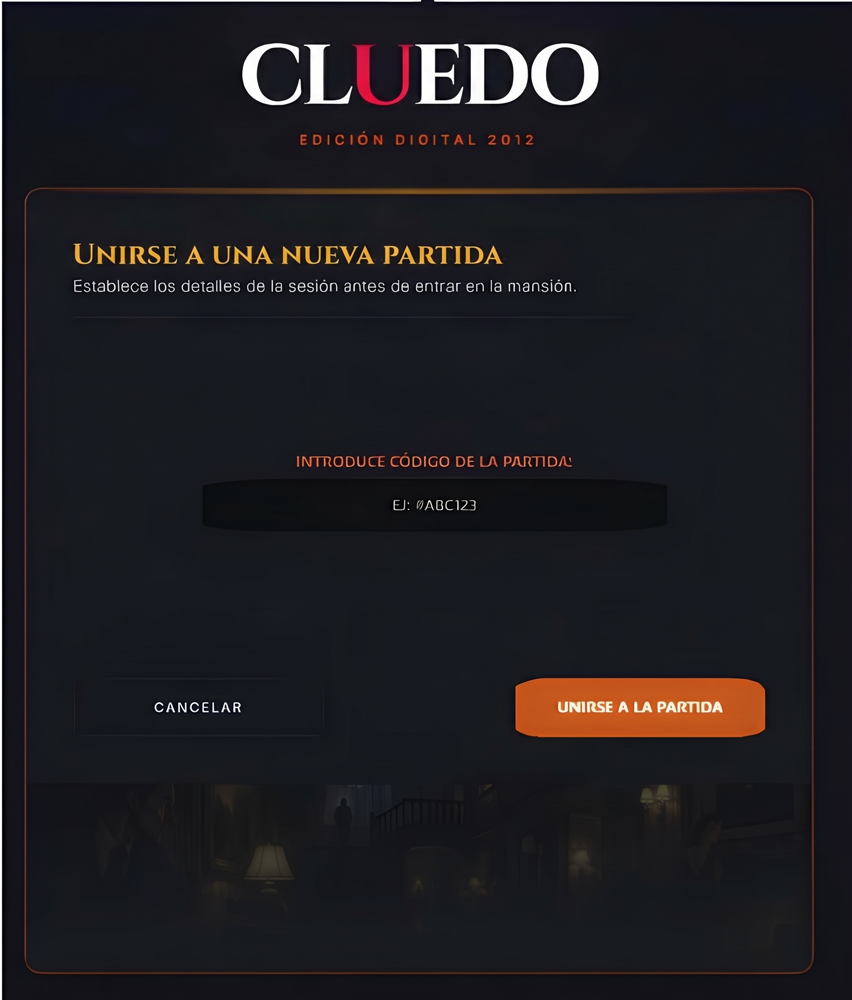

Al seleccionar la opción de unirse a una partida desde el menú principal, la aplicación muestra una pantalla de validación de acceso. El jugador debe introducir el código alfanumérico, generado automáticamente y proporcionado por el creador de la partida, acompañado de un botón de "Unirse a la Partida" y otro de "Cancelar" para regresar al menú. 

Al enviar el código, el frontend hace una consulta al backend para comprobar el estado de la sala. El servidor verifica que la partida existe en la base de datos, que aún se encuentra en espera (es decir, que aún no se encuentre en estado “iniciado”) y que quedan plazas libres. 

Si alguna de estas condiciones falla, el sistema bloquea el avance y muestra un mensaje de error. Si el código es correcto, se avanza automáticamente a la siguiente pantalla de configuración del jugador.

### HU-003: Seleccionar personaje. ([ISSUE#42](https://github.com/gii-is-DP1/dp1-2627-groupproject-L5-5/issues/42))
Como Jugador con acceso validado a una partida, quiero elegir con qué personaje quiero jugar antes de pasar a la sala de espera con mi identidad definida.

Una vez que el sistema ha validado el código, la aplicación muestra una nueva vista en la cual el usuario puede elegir el personaje para la partida. En esta ventana, el jugador visualiza a los seis personajes clásicos del Cluedo (Amapola, Rubio, Blanco, Prado, Celeste o Mora). 

Es importante en este punto que sean elegibles únicamente los personajes que no hayan sido ya seleccionados por jugadores presentes en la partida de manera anterior al usuario que está accediendo. Una vez el usuario selecciona un personaje (entre los disponibles) y pulsa el botón definitivo de "Unirse a la partida", el servidor hace una comprobación de concurrencia de última hora, es decir, que verifica que dos jugadores no hayan elegido de manera simultánea al mismo personaje. De esta manera se evitan conflictos de consistencia y coherencia. 

Si todo es correcto, se vincula al jugador a la partida, bloquea su personaje y redirige la pantalla al Lobby, donde ya aparecerá listado junto al resto de jugadores.

### HU-004:  Acceso y visualización de la sala de espera (Lobby). ([ISSUE#43](https://github.com/gii-is-DP1/dp1-2627-groupproject-L5-5/issues/43))
Como Jugador quiero que el sistema me muestre una sala de espera interactiva tras unirme a una partida para poder saber qué usuarios están conectados y cuándo el creador arranca el juego.

Al acceder a la vista de la sala de espera, la interfaz muestra automáticamente el nombre de la sesión y las tarjetas de perfil de todos los usuarios unidos. El sistema quedará a la a la espera para que, conforme otros amigos se vayan uniendo a la misma sala desde sus ordenadores, el componente de React actualice la interfaz en tiempo real, mostrando las nuevas incorporaciones y el incremento del aforo en la pantalla de todos los participantes sin necesidad de que recarguen el navegador web manualmente.

Si el jugador que visualiza la pantalla es el creador de la sala, verá este botón deshabilitado hasta que el aforo alcance el mínimo de 2 jugadores; una vez cumplido este requisito, el botón se habilitará, permitiéndole hacer clic para enviar la orden al backend que iniciará el juego y forzará la redirección automática de las pantallas de todos los usuarios hacia el tablero. Si el jugador conectado no es el anfitrión de la partida, este botón de arranque estará oculto, con el mensaje "Esperando al anfitrión...", garantizando así que el control de inicio sea solo accesible para el anfitrión de la lobby.

### HU-005:  Expulsión de jugadores en el Lobby. ([ISSUE#44](https://github.com/gii-is-DP1/dp1-2627-groupproject-L5-5/issues/44))
Como Jugador Anfitrión quiero poder expulsar a un usuario concreto de mi sala de espera para poder gestionar quién entra en la partida.

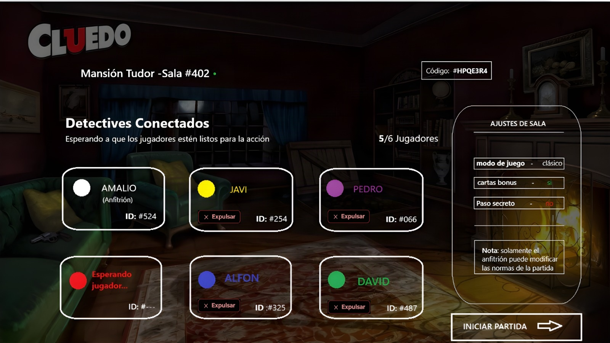

Al encontrarse como Jugador Anfitrión dentro de la sala de espera del juego, cada jugador que se encuentra dentro de la sala dispondrá de un botón interactivo de expulsión,solo visible para el jugador anfitrión, el cual al ser presionado lanzará un modal de confirmación para la expulsión del usuario seleccionado.

### HU-006: Tirada de dados inicial para establecer el orden de los turnos. ([ISSUE#73](https://github.com/gii-is-DP1/dp1-2627-groupproject-L5-5/issues/73))

Como Jugador quiero lanzar los dados en la pantalla del tablero, para poder competir por la mayor puntuación y determinar quién ejecuta el primer turno.

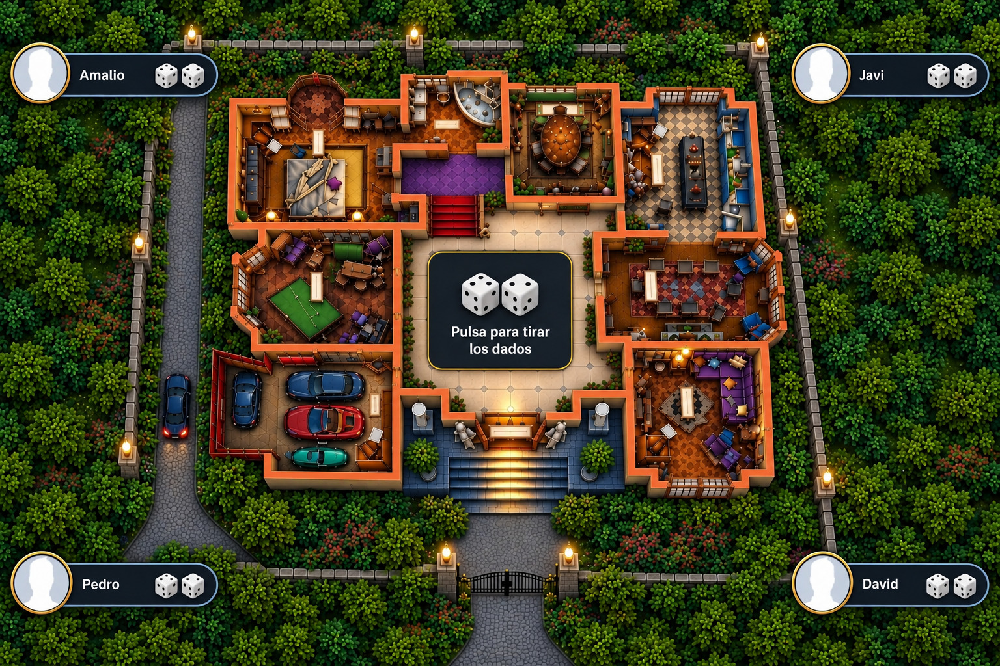

Justo después de que el anfitrión inicie la partida desde el Lobby, el sistema carga el tablero directamente. Al entrar en el tablero salen los perfiles como circulitos con las esquinas del tablero y en el medio de los laterales, dependiendo de cuánta gente haya en la partida, con una imagen de unos dados y un texto de pulse para tirar los dados. Al hacer clic, el frontend envía la petición y el backend calcula un valor aleatorio simulando la tirada de dos dados de 6 caras. A medida que los jugadores tiran, los resultados aparecen en pantalla. El jugador que saque la puntuación más alta será asignado como el primero en actuar, y el resto de turnos se organizan en sentido horario a partir de él. En caso de empate, el sistema gestionará una tirada de desempate automática entre los implicados. Una vez asignado empieza la partida. 

### HU-007: Tirar los dados al inicio del turno. ([ISSUE#74](https://github.com/gii-is-DP1/dp1-2627-groupproject-L5-5/issues/74))
Como Jugador quiero tirar los dados al inicio de mi turno regular para poder obtener el número de casillas posibles que puedo avanzar

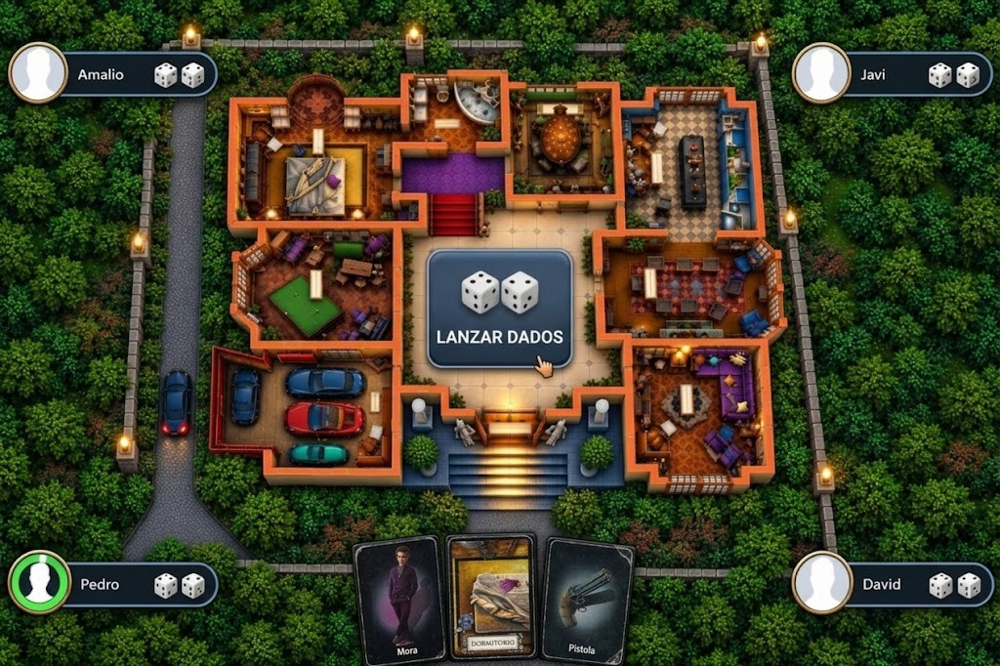

Al arrancar el turno de un jugador,el sistema comprueba la situación del jugador y le habilita el botón de los dados con el texto de “Lanzar dados”. Siguiendo la regla R-N12 (Oferta de opciones de movimiento), al jugador le saldrán las posibles opciones . Cuando el jugador pulsa el botón, se muestra una animación en React y el backend genera el resultado aleatorio. Este resultado numérico se muestra en pantalla y queda registrado temporalmente en el estado del turno para permitir la fase de movimiento. 

### HU-008: Movimiento de la ficha por el tablero hacia una habitación. ([ISSUE#75](https://github.com/gii-is-DP1/dp1-2627-groupproject-L5-5/issues/75))
Como Jugador quiero seleccionar una casilla válida para poder desplazar mi ficha por la mansión en función al resultado obtenido en los dados.

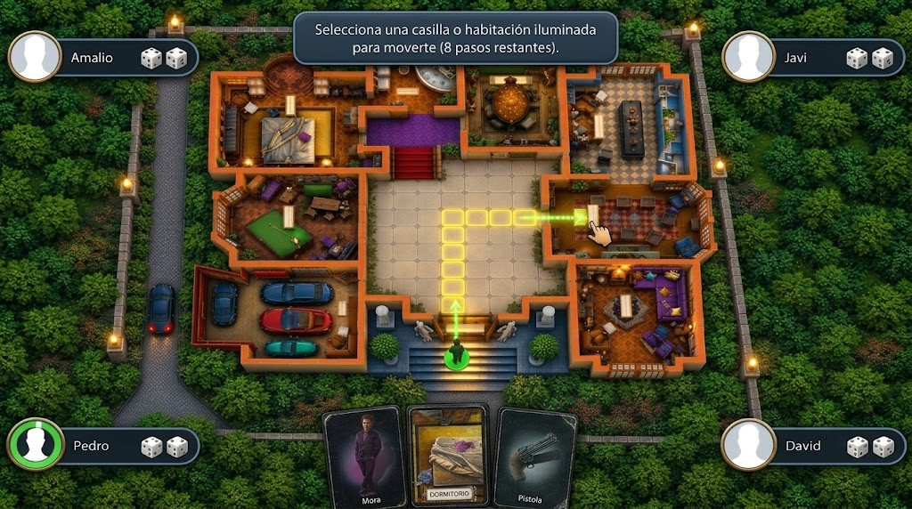

Tras realizar la tirada de dados (HU-007), el tablero interactivo ilumina o resalta únicamente las casillas a las que el jugador puede llegar. Aquí entra en juego la regla RN-11 (Generación de rutas y obstáculos): el backend calcula el camino, considerando el resultado de los dados y bloqueando las casillas de pasillo o entrada a sala en las que ya haya otros jugadores. Además, permite seleccionar cualquier habitación al alcance ya que estas no tienen límite de aforo. El jugador hace clic en la casilla destino iluminada. El frontend envía las coordenadas seleccionadas, el servidor valida que no haya trampas y, si todo es correcto, la ficha se desplaza visualmente hasta la nueva ubicación. 

### HU-009: Uso de pasadizos secretos. ([ISSUE#76](https://github.com/gii-is-DP1/dp1-2627-groupproject-L5-5/issues/76))

Como Jugador situado en una habitación de esquina quiero usar el pasadizo secreto para poder trasladarme a la habitación opuesta sin gastar mi tirada de dados.

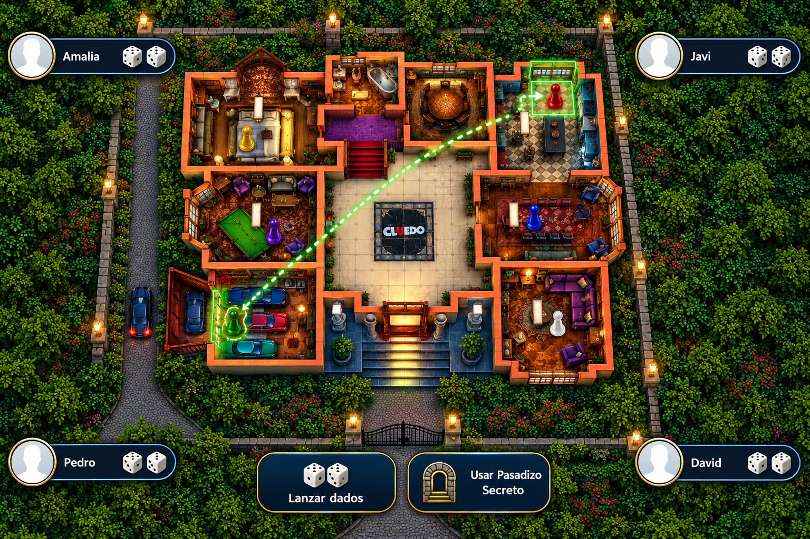

Si al comienzo de su turno el jugador se encuentra situado en una de las cuatro habitaciones de las esquinas del tablero, el sistema, en base a la regla R-N12, le habilitará un botón secundario llamado "Usar Pasadizo Secreto" junto a la opción normal de tirar los dados. Si el jugador pulsa este botón, El servidor ejecuta automáticamente el traslado de la ficha a la habitación diametralmente opuesta. Una vez posicionado en la nueva habitación, el jugador pasaría directamente a la fase de formular una sugerencia.

### HU-010: Robar carta de Pista (Casilla Bonus). ([ISSUE#77](https://github.com/gii-is-DP1/dp1-2627-groupproject-L5-5/issues/77))

Como Jugador que finaliza su movimiento en una casilla con el símbolo de interrogante, quiero que el sistema me muestre una carta del mazo de pistas para poder obtener una ventaja táctica o un turno extra según indique la carta. 

Si tras confirmar su movimiento, la ficha del jugador acaba encima de una casilla bonus, se lanza un evento automático. El sistema extrae la primera carta del mazo de pistas (cartas bonus), muestra un aviso y enseña la carta al jugador. La carta pasa a su mano y el jugador puede elegir jugarla si su efecto está disponible en ese momento o esperar para utilizarla más adelante. Al jugarla, se aplica la regla R-15 y la carta se descarta.

### HU-011: Jugar carta Especial. ([ISSUE#78](https://github.com/gii-is-DP1/dp1-2627-groupproject-L5-5/issues/78))

Como Jugador en mi turno, quiero seleccionar y en caso obligatorio usar la carta especial o por el contrario guardarla para usarla cuando lo vea oportuno.

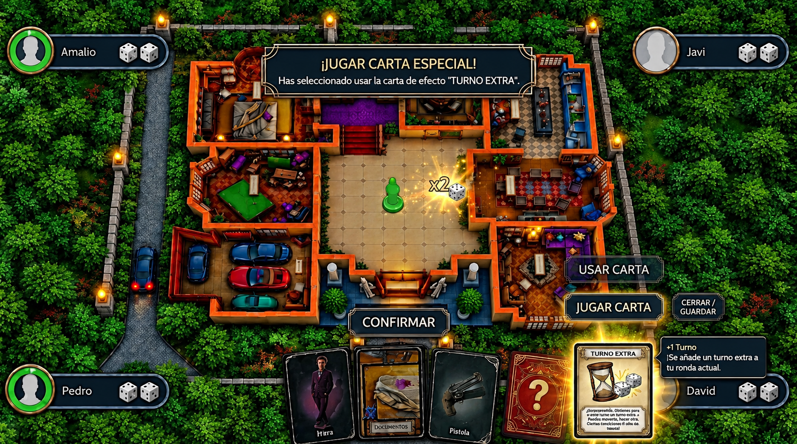

El jugador dispondrá de un apartado visible en su interfaz con las cartas que tiene de inicio y las que ha ido consiguiendo HU-13 . Durante su turno y dependiendo de lo que permita la carta, por ejemplo, antes de tirar los dados o en plena refutación, podrá hacer clic sobre ella para utilizarla. Al activarla, el sistema cumple con la regla R-15 . El efecto de la carta (como añadir 6 al resultado del dado) altera temporalmente el flujo normal de la partida. En cuanto la acción termina, la carta se elimina visualmente de la mano del jugador y el backend la transfiere al mazo de descartes, restaurando las normativas estándar para el resto del turno. 

### HU-012: Temporizador de turno. ([ISSUE#79](https://github.com/gii-is-DP1/dp1-2627-groupproject-L5-5/issues/79))

Como Jugador, quiero ver una cuenta atrás durante el turno activo, para poder agilizar el ritmo de la partida y evitar que alguien se quede inactivo bloqueando el juego.

Durante cada turno, aparecerá un temporizador en la pantalla con el tiempo restante, por ejemplo, 60 segundos. También se mostrará cuando un jugador tenga que responder a la sugerencia de otro. Si el tiempo se agota y el jugador no ha realizado ninguna acción, el 
servidor finalizará automáticamente su turno y aplicará las reglas previstas para estos casos (RN-13).

### HU-013: Ver mis cartas. ([ISSUE#80](https://github.com/gii-is-DP1/dp1-2627-groupproject-L5-5/issues/80))

Como jugador quiero un panel visible con mis cartas en todo momento para poder saber de qué pistas dispongo.

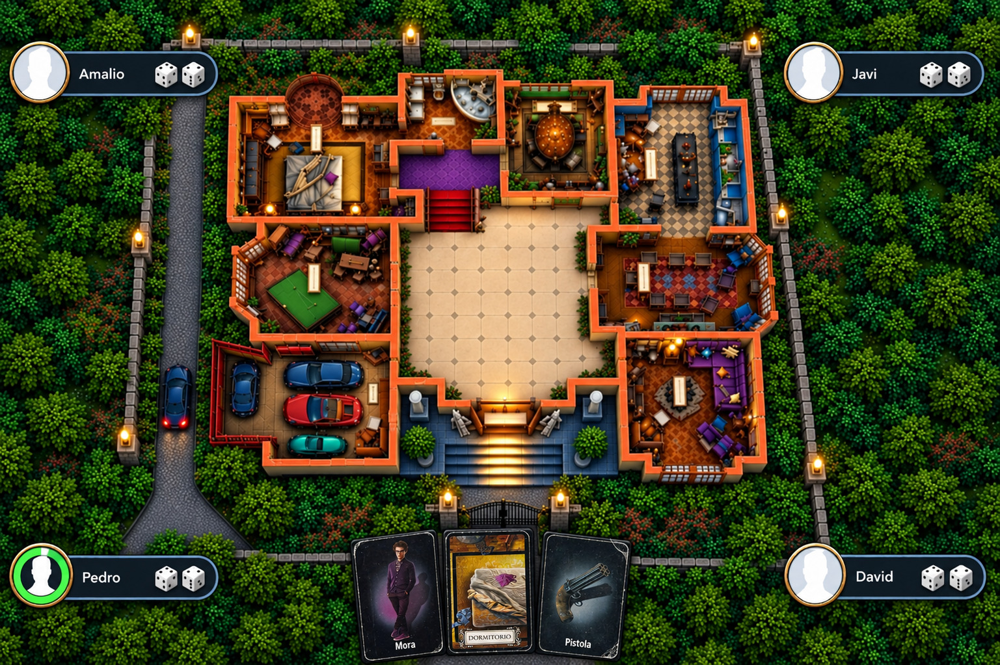

En la pantalla principal habrá un apartado donde aparecerán todas mis cartas, tanto las que recibí al comenzar la partida como las que consiga después. Se incluirán las cartas de sospechosos, armas, habitaciones y cartas bonus. Al entrar en la partida, la aplicación solicitará al servidor las cartas que me pertenecen. Cada jugador solo podrá ver sus propias cartas, evitando que los demás descubran la información de su mano. Además, las cartas cambiarán de aspecto según la situación. Por ejemplo, se destacarán las cartas que pueda utilizar y se oscurecerán las que no

### HU-014: Consultar mi libreta de investigación. ([ISSUE#81](https://github.com/gii-is-DP1/dp1-2627-groupproject-L5-5/issues/81))
Como Jugador quiero disponer de un apartado con la tabla de sospechosos, armas y salas para poder revisar el estado global de mis deducciones.

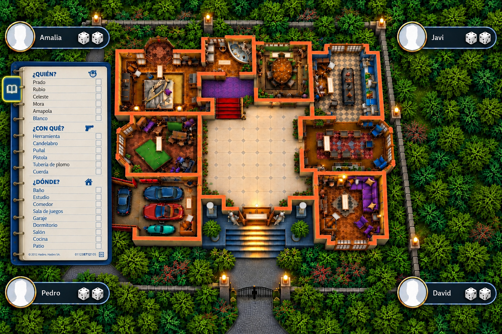

En la pantalla de juego habrá un botón que permitirá abrir la libreta cuando la necesite, sin tener que salir del tablero. Esta estará organizada en tres apartados: sospechosos, armas y habitaciones, igual que en el juego de mesa. La libreta guardará las anotaciones que haya hecho durante la partida. Cada jugador tendrá su propia libreta, por lo que sus anotaciones serán privadas y no podrán ser vistas por los demás. 

### HU-015: Marcar mis anotaciones en la libreta. ([ISSUE#82](https://github.com/gii-is-DP1/dp1-2627-groupproject-L5-5/issues/82))
Como jugador quiero interactuar con mi libreta para poder tachar a los sospechosos que creo que son inocentes.

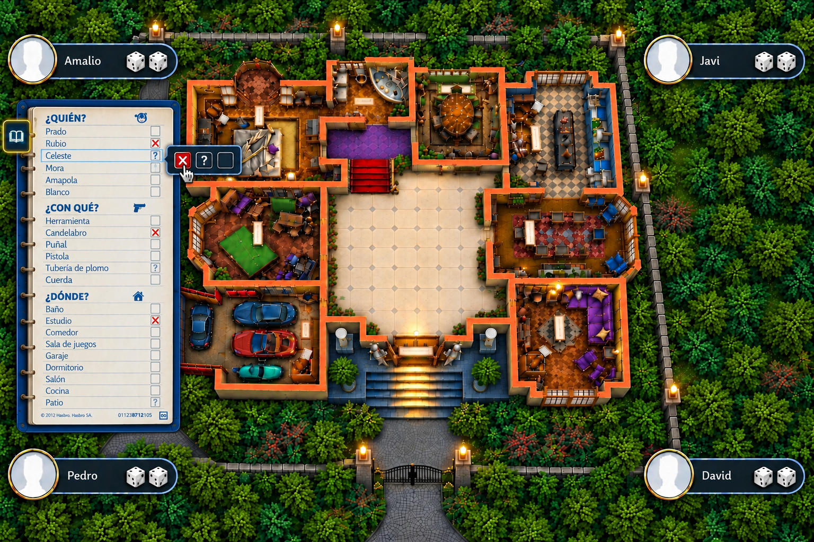

Cuando abra la libreta, podré hacer clic en las casillas de los sospechosos, las armas y las habitaciones para cambiar sus marcas. 
Por ejemplo, podré poner una «X» para descartar una opción, un «?» si todavía tengo dudas o dejar la casilla en blanco si prefiero no marcarla. Cada vez que cambie una casilla, la aplicación guardará la modificación en el servidor. De esta manera, mis anotaciones seguirán ahí aunque cierre el navegador o tenga que abandonar la partida temporalmente.

### HU-016: Formular una sugerencia al entrar en una habitación. ([ISSUE#83](https://github.com/gii-is-DP1/dp1-2627-groupproject-L5-5/issues/83))

Como Jugador quiero seleccionar un personaje y un arma al llegar a una sala para poder formular una hipótesis e interrogar al resto

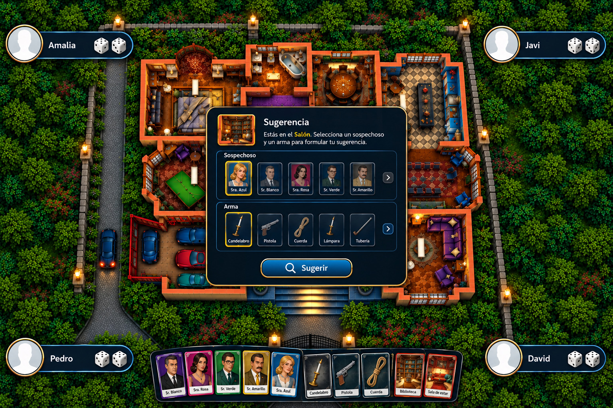

Cuando mi personaje llegue a una habitación, aparecerá automáticamente una ventana para formular una sugerencia. La habitación en la que me encuentre ya estará seleccionada y no podré cambiarla, ya que solo puedo hacer sugerencias relacionadas con la sala en la que estoy (RN-05). Después, elegiré el sospechoso y el arma que quiera incluir en mi teoría. Cuando pulse el botón «Sugerir», el servidor comprobará que todo sea correcto. Si la sugerencia es válida, el personaje y el arma elegidos se trasladarán a esa habitación (RN-06). A continuación, comenzará la fase de refutación, en la que los demás jugadores podrán intentar demostrar que mi teoría no es correcta, siguiendo el orden establecido por las reglas del juego (RN-07). 

### HU-017: Refutar la sugerencia de otro jugador. ([ISSUE#84](https://github.com/gii-is-DP1/dp1-2627-groupproject-L5-5/issues/84))

Como Jugador quiero poder seleccionar una de mis cartas con la sugerencia de un rival para poder refutar su teoría en secreto.

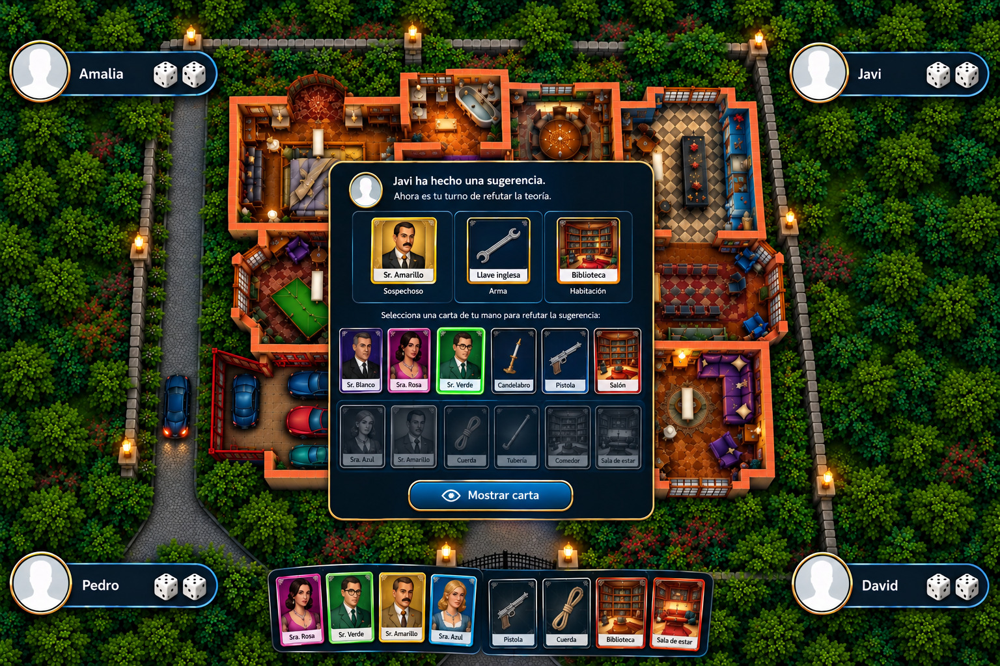

Cuando llegue mi turno de refutar una sugerencia, aparecerá un aviso indicando qué sospechoso, arma y habitación ha elegido el otro jugador. La aplicación revisará mis cartas y destacarán aquellas que coincidan con alguno de los elementos de la sugerencia. Las que no pueda utilizar para refutarla aparecerán oscurecidas. Si tengo varias cartas que sirven para refutar la teoría, podré elegir cuál quiero mostrar, aunque solo podré seleccionar una. Después, pulsaré el botón «Mostrar carta» para enviar mi respuesta. La carta elegida solo podrá verla el jugador que hizo la sugerencia. Los demás recibirán un mensaje indicando que he refutado la teoría, pero no sabrán qué carta he mostrado. Así, se mantiene el secreto de las cartas y se cumple la regla de que solo se puede mostrar una por refutación (RN-08).

### HU-018: Preparar el sobre y repartir las cartas. ([ISSUE#86](https://github.com/gii-is-DP1/dp1-2627-groupproject-L5-5/issues/86))

Como Jugador, quiero que al empezar la partida el sistema guarde en el sobre una carta de sospechoso, una de arma y una de habitación, para que la solución quede oculta hasta la acusación y el resto de cartas se reparta entre los jugadores.

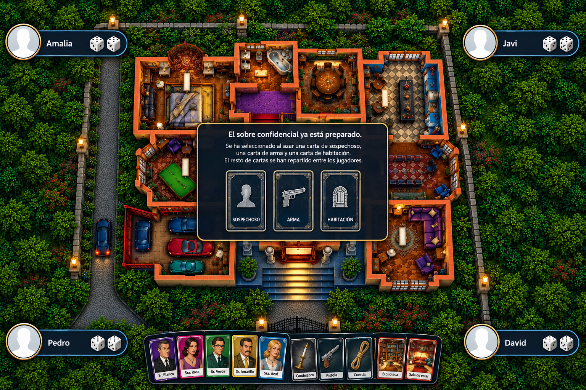

En el momento en que el anfitrión pulsa el botón de "Iniciar Partida" desde el Lobby, el backend ejecuta de forma automática y aislada el algoritmo de preparación del juego. El servidor selecciona aleatoriamente una carta de cada categoría (Sospechoso, Arma y Habitación) y las asocia a una estructura de datos de acceso restringido que representa el "Sobre Confidencial", garantizando que ningún cliente del frontend pueda interceptar la solución de la partida. A continuación, el sistema agrupa y baraja virtualmente todas las cartas de pista sobrantes, asignándolas de manera equitativa a las entidades de cada participante. Si la sesión está configurada para 2 jugadores, el servidor aplicará la variante específica de la edición 2012 (RN-04), separando previamente 4 cartas neutrales que quedarán vinculadas a una zona pública del tablero. Una vez finalizado el reparto en la base de datos, el backend notifica a todos los clientes vía WebSockets para forzar la transición a la vista del tablero, donde el componente de React cargará instantáneamente las cartas asignadas en el panel privado de cada usuario.

### HU-019: Consultar una carta neutral en una partida de dos jugadores ([ISSUE#87](https://github.com/gii-is-DP1/dp1-2627-groupproject-L5-5/issues/87))

Como jugador en una partida de dos, quiero consultar en secreto una carta neutral cuando mi rival no puede refutar, para seguir obteniendo pistas.

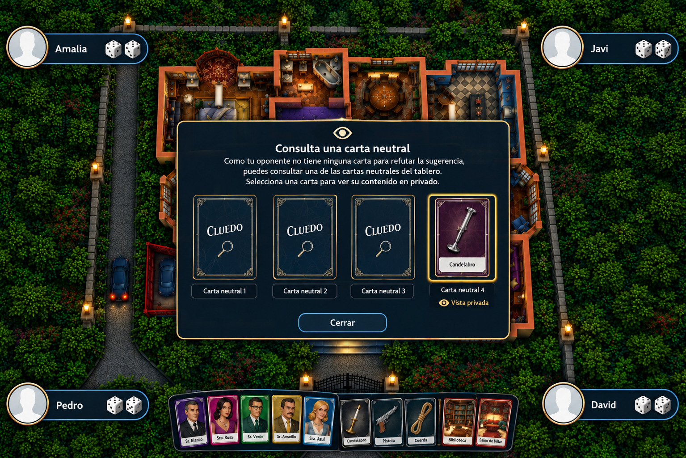

En las partidas de dos jugadores, el sistema aplica la variante especial de las reglas del Cluedo de 2012 (RN-04), dejando cuatro cartas neutrales boca abajo en el tablero durante la preparación de la partida. Cuando un jugador formula una sugerencia y el otro participante no dispone de ninguna carta para refutarla, la aplicación le permitirá consultar una de estas cartas neutrales. Para ello, se mostrará una interfaz en la que podrá seleccionar una de las cartas disponibles y visualizar su contenido de forma privada. El otro jugador no podrá conocer qué carta se ha consultado, manteniendo así el secreto de la información. Una vez consultada, la carta quedará marcada como utilizada para evitar que vuelva a ser revelada por el mismo procedimiento.

### HU-020: Formular la acusación final en la casilla central. ([ISSUE#88](https://github.com/gii-is-DP1/dp1-2627-groupproject-L5-5/issues/88))

Como Jugador quiero seleccionar el trío definitivo de culpable, arma y lugar para poder intentar ganar la partida definitivamente.

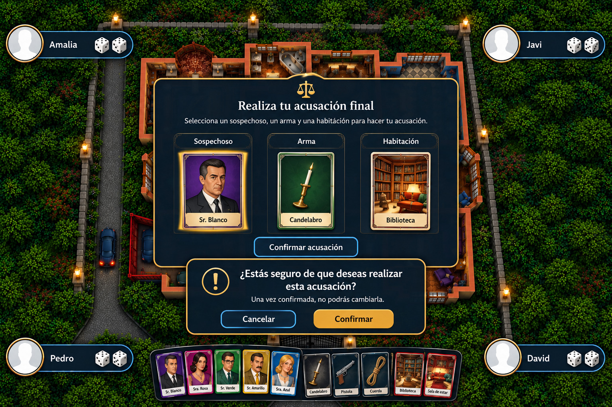

Cuando el jugador considere que ha reunido suficientes pistas, podrá dirigirse a la casilla central del tablero para formular su acusación final. La aplicación mostrará una ventana en la que deberá seleccionar un sospechoso, un arma y una habitación entre las opciones disponibles. Antes de enviar la acusación, el sistema solicitará una confirmación para evitar que se realice por error. Una vez confirmada, el frontend enviará la combinación elegida al backend, que la comparará con las tres cartas guardadas en el sobre confidencial. Si la combinación es correcta, se iniciará el proceso de finalización de la partida y el jugador será declarado ganador. En caso contrario, el sistema lo eliminará de la posibilidad de seguir realizando movimientos y sugerencias, aunque conservará sus cartas para poder continuar refutando las teorías de los demás participantes.

### HU-021: Detección del fin de partida y anuncio del ganador. ([ISSUE#186](https://github.com/gii-is-DP1/dp1-2627-groupproject-L5-5/issues/186))

Como Jugador quiero que el sistema detenga el juego al validarse una acusación para poder ver el anuncio oficial del ganador.

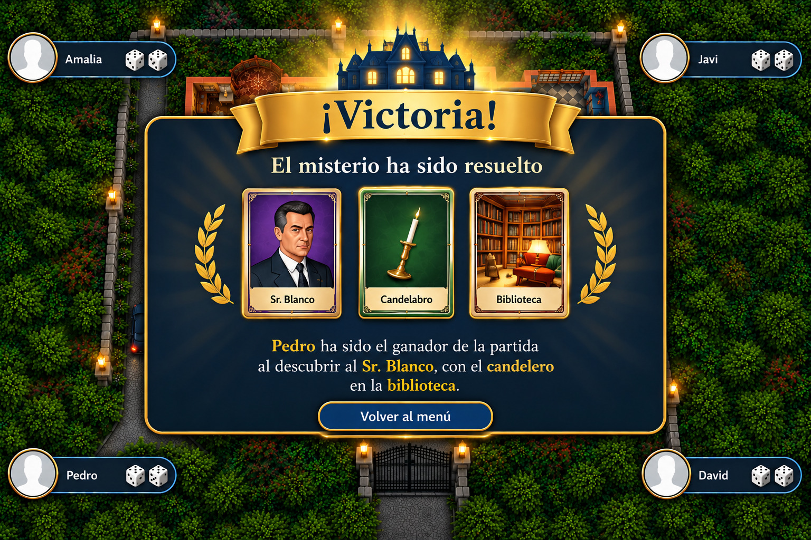

Cuando un jugador realice una acusación final y el servidor compruebe que coincide con las cartas del sobre confidencial, la partida finalizará automáticamente. El backend actualizará el estado de la sesión, registrando que ha terminado y guardando al jugador que ha conseguido resolver el misterio como ganador. A continuación, se notificará a todos los participantes para que sus pantallas se actualicen y dejen de permitir acciones propias de una partida en curso, como lanzar los dados, mover las fichas o formular sugerencias. La interfaz mostrará una pantalla de final de partida en la que aparecerá el nombre y el personaje del ganador, junto con un mensaje anunciando la resolución del misterio. De esta manera, todos los jugadores podrán conocer el resultado sin necesidad de actualizar manualmente la página.

### HU-022: Visualizar el listado de partidas en curso. ([ISSUE#187](https://github.com/gii-is-DP1/dp1-2627-groupproject-L5-5/issues/187))

Como Administrador quiero ver un listado global de las partidas activas para poder supervisar qué salas se están jugando y sus participantes.

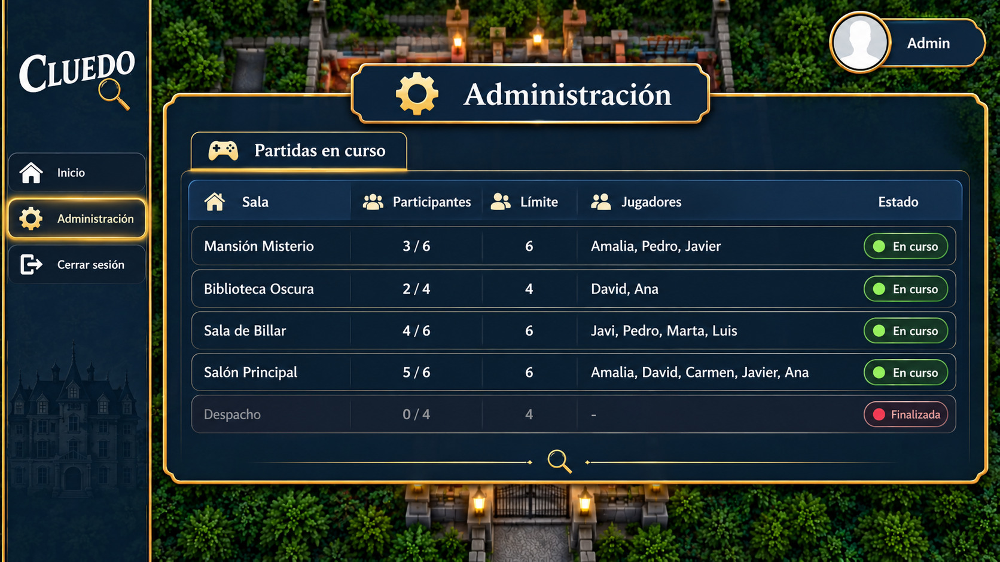

Al acceder al apartado de administración, el usuario con rol de Administrador dispondrá de una sección en la que podrá consultar todas las partidas que se encuentren actualmente en curso. La aplicación mostrará un listado con la información principal de cada sesión, incluyendo el nombre de la sala, el número de participantes, el límite de jugadores y los usuarios que están participando. El sistema obtendrá estos datos del backend y los presentará de forma organizada para facilitar su consulta. Además, el listado permitirá identificar rápidamente qué partidas continúan activas y cuáles han dejado de estar disponibles al finalizar. El acceso a esta funcionalidad estará restringido a los administradores, evitando que los jugadores normales puedan consultar el listado global de sesiones desde este apartado.

### HU-023: Visualizar el listado de partidas jugadas por el usuario actual ([ISSUE#188](https://github.com/gii-is-DP1/dp1-2627-groupproject-L5-5/issues/188))
Como Jugador quiero acceder a mi historial para poder revisar las partidas que he creado y jugado anteriormente.

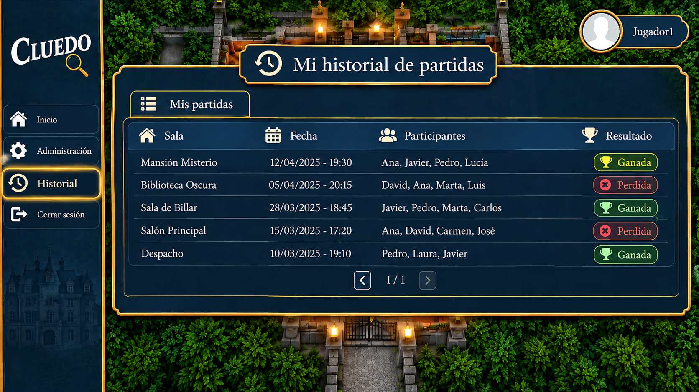

Desde el menú principal, el jugador podrá acceder a un apartado de historial en el que aparecerán las partidas en las que haya participado con su cuenta. La aplicación solicitará al backend las sesiones asociadas al usuario autenticado y mostrará un listado con información relevante, como el nombre de la sala, la fecha de la partida, los participantes y el resultado obtenido. De esta manera, el usuario podrá consultar tanto las partidas que ha ganado como aquellas en las que no ha conseguido resolver el misterio. El sistema garantizará que cada jugador solo pueda acceder a su propio historial, evitando que pueda consultar los registros privados de otros usuarios. Si todavía no ha participado en ninguna partida, se mostrará un mensaje indicando que no existen partidas anteriores.

### Módulo 2 - Gestión de Usuarios y Administración
### HU-024: Registro de un nuevo usuario en el sistema (Sign-up) ([ISSUE#189](https://github.com/gii-is-DP1/dp1-2627-groupproject-L5-5/issues/189))
Como Jugador quiero rellenar un formulario con mis datos para poder crear una cuenta nueva y acceder a la plataforma.

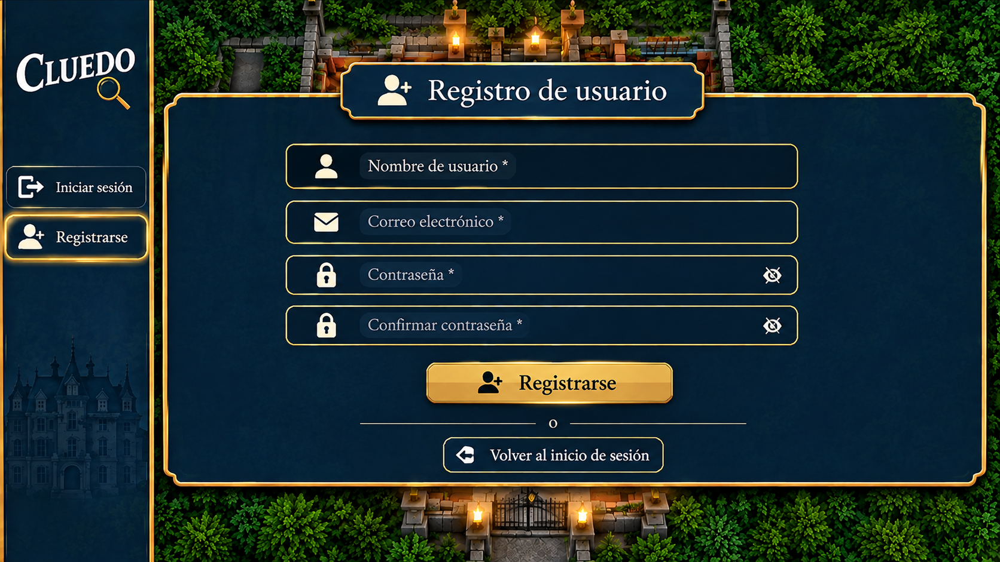

Desde la pantalla inicial, cualquier visitante podrá acceder a la opción de registro para crear una cuenta en la aplicación. Al seleccionarla, se mostrará un formulario en el que deberá introducir los datos necesarios para darse de alta, como el nombre de usuario, el correo electrónico y una contraseña, además de su confirmación. Cuando pulse el botón de registro, el frontend enviará la información al backend para comprobar que los campos obligatorios estén completos, que los datos tengan un formato válido y que el nombre de usuario y el correo electrónico no estén registrados previamente. Si alguna de estas comprobaciones falla, la aplicación mostrará un mensaje indicando el error para que el usuario pueda corregirlo. Si la validación es satisfactoria, el sistema almacenará la nueva cuenta en la base de datos y confirmará que el registro se ha realizado correctamente. Finalmente, el usuario podrá dirigirse a la pantalla de inicio de sesión para acceder a la plataforma con sus nuevas credenciales.

### HU-025: Inicio de sesión en la aplicación web (Login) ([ISSUE#190](https://github.com/gii-is-DP1/dp1-2627-groupproject-L5-5/issues/190))
Como Jugador quiero introducir mis credenciales para poder autenticarse y entrar al sistema de juego.

Cuando un usuario acceda a la opción de iniciar sesión desde la pantalla principal, la aplicación mostrará un formulario en el que podrá introducir su nombre de usuario o correo electrónico y su contraseña. Al pulsar el botón de acceso, el frontend enviará las credenciales al backend, que comprobará si corresponden con una cuenta registrada y verificará que sean correctas. Si los datos introducidos no son válidos, el sistema mostrará un mensaje de error y permitirá volver a intentarlo sin abandonar el formulario. Si la autenticación se completa correctamente, el backend establecerá la sesión del usuario y la aplicación lo redirigirá al menú principal. A partir de ese momento, el jugador podrá acceder a las funcionalidades disponibles para su cuenta, como crear partidas, unirse a salas existentes, consultar su perfil o revisar su historial de partidas.

### HU-026: Cierre de sesión seguro (Logout) ([ISSUE#191](https://github.com/gii-is-DP1/dp1-2627-groupproject-L5-5/issues/191))
Como Jugador quiero pulsar un botón de salida para poder cerrar mi sesión de forma segura.

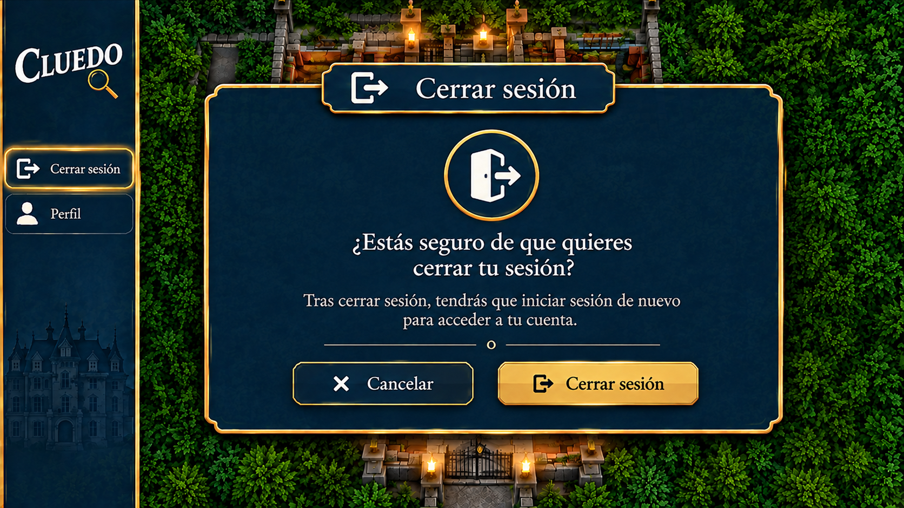

Una vez que el usuario haya iniciado sesión, la aplicación mostrará una opción para cerrar su sesión, normalmente accesible desde el menú principal o desde su perfil personal. Al pulsar el botón de «Cerrar sesión», el frontend enviará una petición al backend para finalizar la sesión activa del usuario. El servidor invalidará la autenticación correspondiente, evitando que otras personas puedan seguir accediendo a la cuenta utilizando la sesión anterior. Una vez completado el proceso, la aplicación eliminará la información de autenticación almacenada en el cliente y redirigirá automáticamente al usuario a la pantalla inicial. Desde ese momento, para volver a utilizar las funcionalidades privadas de la plataforma, será necesario introducir de nuevo las credenciales de acceso.

### HU-027: Visualización y edición del perfil personal del jugador ([ISSUE#192](https://github.com/gii-is-DP1/dp1-2627-groupproject-L5-5/issues/192))

Como Jugador quiero acceder a mis ajustes para poder modificar mi información personal y avatar.

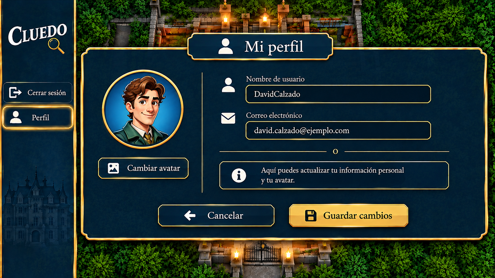

Desde el menú principal, el usuario podrá acceder a su perfil personal para consultar la información asociada a su cuenta. En esta pantalla aparecerán sus datos principales, como el nombre de usuario, el correo electrónico y el avatar que utiliza dentro de la plataforma. Además, dispondrá de una opción para editar su información y seleccionar una nueva imagen de perfil. Cuando realice alguna modificación y pulse el botón de guardar, el frontend enviará los cambios al backend, que comprobará que los nuevos datos sean válidos y que no entren en conflicto con los de otros usuarios registrados. Si la validación es correcta, se actualizará la información en la base de datos y los cambios aparecerán reflejados en la interfaz. En caso de producirse algún error, se mostrará un mensaje indicando el problema y se conservarán los datos anteriores.

### HU-028: Visualización del listado global de usuarios registrados ([ISSUE#193](https://github.com/gii-is-DP1/dp1-2627-groupproject-L5-5/issues/193))

Como Jugador quiero ver un listado paginado para poder buscar y conocer a otros miembros registrados.

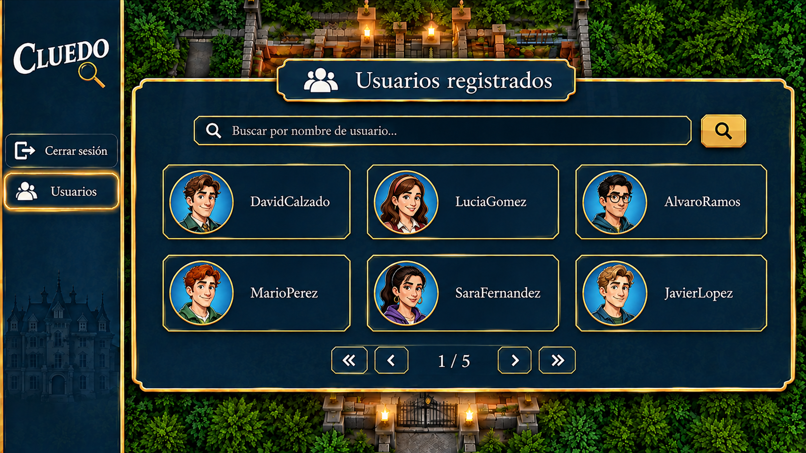

Desde la aplicación, los jugadores podrán acceder a una sección en la que se mostrará un listado de los usuarios registrados en la plataforma. La interfaz presentará la información pública de cada perfil, como su nombre de usuario y avatar, permitiendo identificar a los distintos miembros de la comunidad. Para facilitar la consulta, el listado estará organizado en páginas, evitando tener que cargar todos los usuarios simultáneamente. Además, se incluirá una opción de búsqueda que permitirá localizar a otros jugadores introduciendo su nombre de usuario. El frontend solicitará al backend los resultados correspondientes y actualizará el listado según los criterios introducidos. De esta manera, los usuarios podrán encontrar fácilmente a otros miembros de la plataforma y acceder a la información pública de sus perfiles.

### HU-029: Crear perfiles de usuario (Create) ([ISSUE#194](https://github.com/gii-is-DP1/dp1-2627-groupproject-L5-5/issues/194)) 
Como Administrador, quiero poder dar de alta nuevos perfiles de usuario en el sistema, para poder registrar manualmente a los usuarios cuando sea necesario.

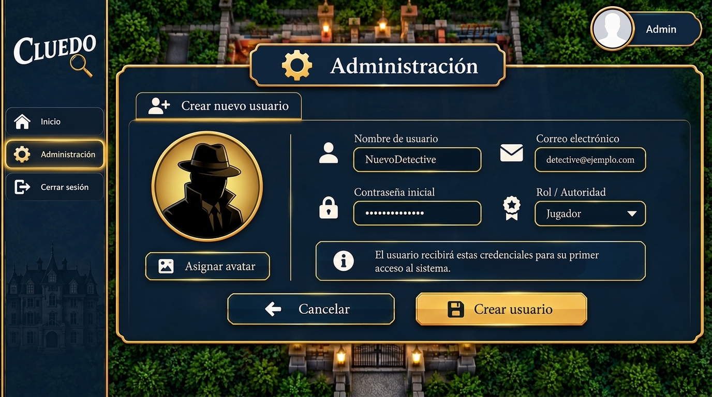

Dentro del apartado de administración, el usuario con permisos de Administrador dispondrá de una opción para crear nuevas cuentas de usuario manualmente. Al acceder a ella, se mostrará un formulario con los campos necesarios para registrar un nuevo perfil, como el nombre de usuario, el correo electrónico y las credenciales correspondientes, además de los datos adicionales que permita gestionar el sistema. Cuando el administrador complete el formulario y pulse el botón de creación, el frontend enviará la información al backend para realizar las comprobaciones necesarias. El servidor verificará que los campos obligatorios estén cumplimentados y que no exista previamente otra cuenta con el mismo nombre de usuario o correo electrónico. Si todos los datos son correctos, se almacenará el nuevo perfil en la base de datos y se mostrará una notificación confirmando que el usuario se ha creado correctamente. En caso contrario, se informará al administrador de los errores detectados para que pueda corregirlos.

### HU-030: Consultar perfiles de usuario (Read) ([ISSUE#195](https://github.com/gii-is-DP1/dp1-2627-groupproject-L5-5/issues/195))
Como Administrador, quiero poder ver el listado completo y acceder a los detalles de cualquier usuario de la base de datos, para poder revisar su información e identificar posibles perfiles problemáticos.

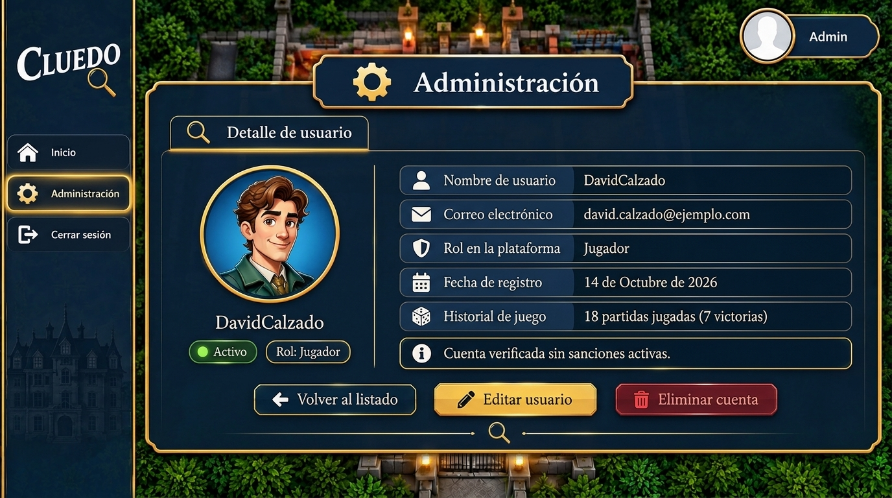

Al acceder a la gestión de usuarios, el administrador dispondrá de un listado general con los perfiles registrados en la plataforma. La interfaz mostrará los datos principales de cada cuenta, como el nombre de usuario, el correo electrónico y su estado dentro del sistema. Para facilitar la consulta, se podrán utilizar las opciones de búsqueda y navegación disponibles en el listado. Cuando el administrador seleccione un usuario concreto, la aplicación mostrará una pantalla de detalle con toda la información del perfil que pueda consultar desde este apartado. El frontend solicitará estos datos al backend, que comprobará que el usuario autenticado dispone de permisos de administración antes de facilitar la información. De esta manera, se centraliza la consulta de las cuentas registradas y se permite al administrador supervisar los perfiles de la plataforma desde un único lugar.

### HU-031: Actualizar perfiles de usuario (Update) ([ISSUE#196](https://github.com/gii-is-DP1/dp1-2627-groupproject-L5-5/issues/196))
Como Administrador, quiero poder editar y modificar la información de los perfiles de usuario existentes, para poder corregir datos erróneos, gestionar permisos o cambiar su estado (ej. suspender o bloquear temporalmente a un usuario problemático).

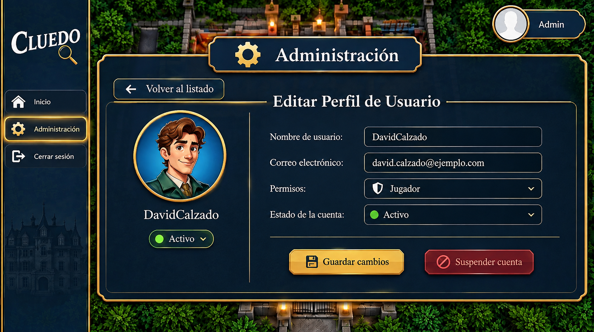

Desde el apartado de gestión de usuarios, el administrador podrá seleccionar cualquier perfil registrado y acceder a una opción para modificar sus datos. La aplicación mostrará un formulario con la información actual del usuario, permitiendo editar los campos que estén habilitados para su modificación, como el nombre de usuario, el correo electrónico, los permisos o el estado de la cuenta. Una vez realizados los cambios, el administrador deberá pulsar el botón de guardar para que el frontend envíe la información actualizada al backend. El servidor comprobará que los nuevos datos sean válidos y que el usuario que realiza la operación tenga los permisos necesarios. Si las comprobaciones se superan correctamente, se actualizará el perfil en la base de datos y se notificará al administrador de que los cambios se han guardado. Si se produce algún error, se mostrará el motivo y se mantendrá la información anterior del usuario.

### HU-032: Eliminar perfiles de usuario (Delete) ([ISSUE#197](https://github.com/gii-is-DP1/dp1-2627-groupproject-L5-5/issues/197))
Como Administrador, quiero poder borrar perfiles de la base de datos de usuarios, para eliminar de forma definitiva del sistema a los usuarios que sean problemáticos o incumplan las normativas.

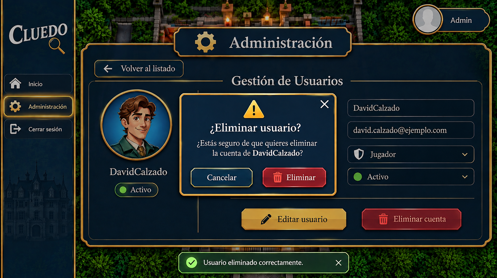

Dentro del apartado de administración, el usuario con rol de Administrador podrá seleccionar un perfil y utilizar la opción de eliminar cuenta. Para evitar que se produzcan borrados accidentales, al pulsar esta opción se mostrará una ventana de confirmación con la información básica del usuario que se desea eliminar. Si el administrador confirma la operación, el frontend enviará una petición al backend para ejecutar el borrado. El servidor comprobará que la operación esté autorizada y gestionará las posibles relaciones del usuario con otros elementos de la aplicación, evitando que se generen referencias inconsistentes en la base de datos. Una vez completada la operación, el perfil dejará de aparecer en el listado de usuarios y la interfaz mostrará una notificación indicando que la eliminación se ha realizado correctamente. Si se produce algún problema durante el proceso, se informará al administrador y no se mostrará el borrado como completado.

### Módulo 3 - Social
### HU-033: Enviar una invitación de amistad a otro usuario ([ISSUE#198](https://github.com/gii-is-DP1/dp1-2627-groupproject-L5-5/issues/198))
Como Jugador quiero buscar a un usuario y pulsar "Añadir amigo" para poder conectarme con él.

Desde el apartado social de la aplicación, el jugador podrá buscar a otros usuarios registrados para enviarles una invitación de amistad. Para ello, dispondrá de un buscador en el que podrá introducir el nombre de usuario de la persona a la que desea encontrar. Una vez localice el perfil correspondiente, la aplicación mostrará su información pública y un botón de «Añadir amigo» para enviar la solicitud. Al pulsarlo, el frontend enviará una petición al backend, que comprobará que el destinatario existe, que no se trata del propio usuario y que no existe ya una relación de amistad o una invitación pendiente entre ambos. Si todas las comprobaciones son correctas, el sistema registrará la invitación y notificará que ha sido enviada correctamente. El usuario que la recibe podrá consultar la solicitud desde su apartado de invitaciones, mientras que el emisor podrá identificar que su petición se encuentra pendiente de respuesta.

### HU-034: Gestión del listado de amistades 
Como Jugador, quiero un panel social para poder aceptar, rechazar o eliminar a personas de mi lista de amigos.
### HU-035: Notificación de amigos en línea en el inicio 
Como Jugador quiero ver un indicador de presencia en el menú para poder saber qué amigos están conectados ahora mismo.
### HU-036: Invitaciones directas a amigos para unirse a partidas 
Como Jugador quiero seleccionar a un amigo desde el lobby para poder enviarle una invitación directa.
### Módulo 4 - Estadísticas y Logros
### HU-037: Consultar el catálogo de logros disponibles 
Como Jugador quiero ver una vista con todos los logros configurados en el sistema para poder conocer los requisitos exactos para desbloquearlos.
### HU-038: Evaluación y desbloqueo de logros de participación 
Como Jugador quiero que el sistema evalúe mi número de partidas jugadas al terminar la partida para poder conseguir la insignia correspondiente.
### HU-039: Evaluación y desbloqueo de logros de victoria 
Como Jugador quiero que el sistema evalúe mis victorias totales tras el acierto final para poder desbloquear automáticamente el logro de las partidas ganadas.
### HU-040: Crear nuevos logros (Create) 
Como Administrador quiero definir un nuevo logro especificando lo que evalúa y su límite numérico para poder añadir nuevos retos al juego.
### HU-041: Consultar el listado de logros configurados (Read) 
Como Administrador quiero visualizar todos los logros activos para poder revisar qué metas están operativas actualmente en la base de datos.
### HU-042: Editar un logro (Update) 
Como Administrador quiero modificar el límite numérico de un logro existente (ej. subir el requisito de 8 a 10 partidas jugadas) para poder balancear la dificultad del juego.
### HU-043: Eliminar logros (Delete) 
Como Administrador quiero borrar un logro de la base de datos para poder retirarlo del catálogo si ya no quiero que los jugadores lo consigan.

## Diagrama conceptual del sistema

El diagrama recoge solo conceptos del juego. No incluye identificadores técnicos, clases de infraestructura, servicios, repositorios ni controladores. Los atributos figuran por su nombre, sin tipo de dato. Las restricciones simples van en notas. Las asociaciones no indican navegabilidad de software.

```mermaid
classDiagram
    User "1" -- "0..*" Player : participa
    User "1" -- "0..*" Game : anfitrion
    Game "1" -- "1..6" Player : reune
    Game "0..1" -- "0..1" Player : ganador

    Game "1" -- "0..1" Board : seJuegaEn
    Board "1" *-- "1..*" Box : contiene
    Box "0..1" -- "0..1" Box : pasadizo
    Player "0..*" -- "0..1" Box : ocupa

    Game "1" -- "0..6" WeaponToken : coloca
    WeaponToken "0..*" -- "0..1" Box : reposa

    Game "1" -- "0..*" Turn : seDivideEn
    Turn "0..*" -- "1" Player : corresponde
    Turn "1" -- "0..1" Suggestion : formula
    Suggestion "0..*" -- "0..1" Player : responde
    Suggestion "0..*" -- "0..1" Player : consulta
    Suggestion "0..*" -- "0..1" GameCard : muestra

    Game "1" -- "0..1" GameDeck : reparte
    GameDeck "1" *-- "0..18" GameCard : agrupa
    GameCard "0..*" -- "0..1" Player : pertenece
    GameCard <|-- RoomCard
    GameCard <|-- WeaponCard
    GameCard <|-- CharacterCard

    Game "1" -- "0..1" BonusDeck : incluye
    BonusDeck "1" *-- "0..*" BonusCard : agrupa
    BonusCard "0..*" -- "0..1" Player : guarda

    Game "1" -- "0..1" Solution : oculta
    Player "1" -- "0..*" NotebookMark : anota

    Game "1" -- "0..*" BonusCardReveal : registra
    Player "1" -- "0..*" BonusCardReveal : solicita
    Player "1" -- "0..*" BonusCardReveal : esConsultado
    BonusCardReveal "0..*" -- "0..1" GameCard : revela

    class User {
        username
        password
        authority
    }

    class Player {
        character
        turnOrder
        initialDiceResult
        initialDiceOne
        initialDiceTwo
        eliminated
        lastSuggestionRoom
    }

    class Game {
        name
        code
        maxPlayers
        status
    }

    class Board {
        width
        height
    }

    class Box {
        x
        y
        type
        room
    }

    class WeaponToken {
        weapon
    }

    class Turn {
        turnNumber
        status
        diceResult
        diceOne
        diceTwo
        hasMoved
        movementBonus
        extraTurn
        startedAt
        expiresAt
    }

    class Suggestion {
        room
        character
        weapon
        status
        finalAccusation
    }

    class GameDeck

    class GameCard {
        <<abstract>>
        hidden
    }

    class RoomCard {
        room
    }

    class WeaponCard {
        weapon
    }

    class CharacterCard {
        character
    }

    class BonusDeck

    class BonusCard {
        effect
        immediate
        used
        deckOrder
    }

    class Solution {
        characterSolution
        weaponSolution
        roomSolution
    }

    class NotebookMark {
        category
        value
        character
        weapon
        room
    }

    class BonusCardReveal

    class CharacterType {
        <<enumeration>>
        AMAPOLA
        RUBIO
        BLANCO
        PRADO
        CELESTE
        MORA
    }

    class WeaponType {
        <<enumeration>>
        CANDELABRO
        CUCHILLO
        TUBERIA_PLOMO
        PISTOLA
        CUERDA
        LLAVE_INGLESA
    }

    class RoomType {
        <<enumeration>>
        KITCHEN
        DINING_ROOM
        LOUNGE
        PATIO
        GAME_ROOM
        STUDY
        BEDROOM
        BATHROOM
        GARAGE
        CENTER
    }

    note for User "username obligatorio y unico. password obligatoria. authority obligatorio: PLAYER o ADMIN"
    note for Game "name obligatorio, longitud 3 a 40, no repetido entre partidas en espera. code obligatorio, unico, 6 caracteres A-Z o 0-9. maxPlayers obligatorio, minimo 2 y maximo 6. status obligatorio: WAITING, STARTED o ENDED. Para iniciar: lo pide el anfitrion; minimo 2 jugadores en modo de dos y minimo 3 en modo clasico"
    note for Player "character obligatorio y unico dentro de la partida. Un mismo usuario no se repite en la misma partida. eliminated obligatorio. turnOrder, si existe, minimo 1"
    note for Board "width y height obligatorios, minimo 1. El tablero de la mansion es 21 por 19. Se crea al iniciar la partida"
    note for Box "x e y obligatorias, minimo 0, unicas en el tablero. type obligatorio: PATH, DOOR, ROOM, BONUS o SECRET_PASSAGE. room solo si la casilla pertenece a una habitacion. En pasillo o puerta solo cabe una ficha; en habitacion caben varias"
    note for WeaponToken "weapon obligatorio y unico en la partida. Al iniciar hay una ficha por cada arma, en su habitacion inicial"
    note for Turn "turnNumber obligatorio, minimo 1. status obligatorio: PENDING, ACTIVE, FINISHED o TIMEOUT. startedAt obligatorio. Como mucho una sugerencia por turno"
    note for Suggestion "room, character, weapon, status y finalAccusation obligatorios. status: PENDING, REFUTED o NOT_REFUTED. room es la habitacion en la que esta la ficha"
    note for GameCard "hidden obligatorio. Sin propietario si es carta neutral o sobrante. Al iniciar hay 18 cartas en el mazo: las 3 de la solucion no se reparten. En partidas de 2 se apartan 4 cartas ocultas sin propietario"
    note for RoomCard "room obligatorio. CENTER no es carta de habitacion"
    note for WeaponCard "weapon obligatorio"
    note for CharacterCard "character obligatorio"
    note for BonusDeck "Solo existe si la partida tiene mas de 2 jugadores. No se usa en el modo de dos"
    note for BonusCard "effect, immediate y used obligatorios. effect: EXTRA_DICE_6, EXTRA_TURN, TELEPORT_ANY_ROOM, PEEK_CARD, EXTRA_QUESTION, REVEAL_CARD o SKIP_REFUTATION. Sin jugador si sigue en el mazo o esta descartada"
    note for Solution "characterSolution, weaponSolution y roomSolution obligatorios. Una sola solucion por partida, creada al iniciar y oculta hasta la acusacion"
    note for NotebookMark "category y value obligatorios. category: SUSPECT, WEAPON o ROOM. value: BLANK, X o QUESTION. Exactamente uno de character, weapon o room, segun category. Una sola marca por jugador y elemento"
    note for BonusCardReveal "Cada revelacion tiene un jugador que solicita y otro distinto que es consultado. La carta revelada es opcional hasta que se resuelve"
```

Un usuario de la plataforma no es, por sí mismo, un jugador de una partida. La participación se modela con `Player`: cada participación pertenece a un usuario y a una partida, y lleva el personaje elegido en esa partida. El mismo usuario puede participar en varias partidas con personajes distintos. Por eso no hace falta una clase intermedia aparte, ni una herencia entre usuario y jugador.

El anfitrión es el usuario que crea la sala. El ganador, si la partida ya ha terminado, es uno de sus jugadores. El tablero, el mazo, el sobre, las fichas de arma y la libreta aparecen al iniciar la partida; durante la espera la sala solo tiene jugadores. Las fichas de personaje son los propios jugadores colocados en una casilla. Las fichas de arma son `WeaponToken`.

El mismo diagrama, sin las notas de restricciones:

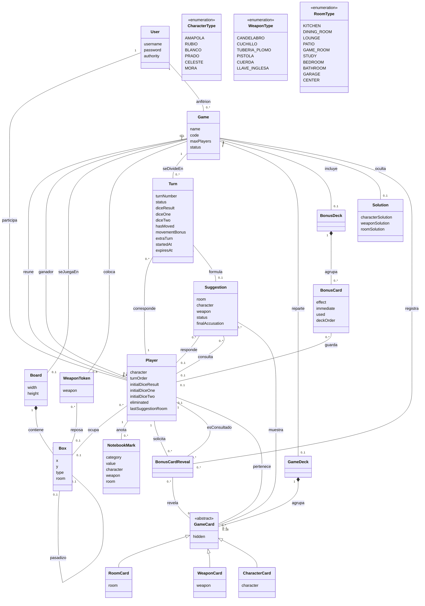

## Reglas de Negocio

Cada regla indica la historia o historias a las que restringe. La historia describe lo que el jugador hace; la regla, la condición que el sistema debe cumplir.

### RN-1: Mínimo de jugadores para iniciar
**Aplica a:** HU-004

La partida solo pasa a activa si lo pide el anfitrión y el aforo es válido: al menos 2 jugadores en el modo de dos y al menos 3 en el modo clásico.

### RN-2: Bloqueo de personajes
**Aplica a:** HU-001, HU-003, HU-005

Un personaje ya elegido no puede cogerlo otro jugador. Si quien lo tenía sale de la sala antes de empezar (expulsión o desconexión), el personaje vuelve a quedar libre. Dos jugadores no pueden quedarse con el mismo personaje.

### RN-3: Reparto equitativo y secreto
**Aplica a:** HU-018

Las tres cartas del sobre se eligen al azar y ningún jugador las conoce hasta que se resuelve la partida. El resto se reparte a partes iguales. Si sobran cartas, quedan visibles para todos.

### RN-4: Cartas neutrales en partidas de dos jugadores
**Aplica a:** HU-010, HU-011, HU-018, HU-019

En una partida de dos, antes del reparto se apartan 4 cartas boca abajo en una zona neutral y las cartas especiales no se usan. Una carta neutral solo puede consultarse si el rival no tiene ninguna carta para refutar la sugerencia.

### RN-5: La sugerencia solo vale en la habitación actual
**Aplica a:** HU-016

No se puede sugerir si el jugador no está en una habitación, ni si la sala propuesta no es la habitación en la que está su ficha.

### RN-6: Teletransporte al sugerir
**Aplica a:** HU-016

Si la sugerencia cumple la RN-5, el personaje y el arma mencionados se mueven a esa habitación, estén donde estén.

### RN-7: Orden de la refutación
**Aplica a:** HU-016, HU-017

Tras una sugerencia se pregunta al resto en orden de turno. Si un jugador tiene alguna carta de la sugerencia, la refutación se detiene. Si no tiene ninguna, se pasa al siguiente, hasta el jugador anterior a quien sugirió.

### RN-8: El jugador elige qué carta enseñar
**Aplica a:** HU-017

Si tiene más de una carta que coincide con la sugerencia, no se enseña ninguna por defecto: elige cuál mostrar.

### RN-9: Acierto y fallo de la acusación
**Aplica a:** HU-008, HU-016, HU-017, HU-020, HU-021

Si las tres cartas coinciden con el sobre, la partida termina y ese jugador gana. Si no, queda eliminado: no se mueve ni sugiere, pero sus cartas siguen sirviendo para refutar.

### RN-10: No repetir sugerencia en la misma habitación
**Aplica a:** HU-016

No se puede volver a sugerir desde la misma habitación si el jugador no ha salido a un pasillo. Si su ficha llegó allí porque otro jugador la incluyó en una sugerencia, puede sugerir desde esa habitación sin tirar los dados.

### RN-11: Casillas ocupadas y habitaciones compartidas
**Aplica a:** HU-008

Un pasillo o una puerta ocupados no forman parte de la ruta, y el recorrido no supera la tirada. En una habitación pueden coincidir varios jugadores.

### RN-12: Opciones de movimiento al empezar el turno
**Aplica a:** HU-007, HU-008, HU-009

Al empezar el turno el jugador solo puede moverse con los dados, usar un pasadizo si está en una habitación de esquina, o no moverse si fue teletransportado en la ronda anterior por la RN-6.

### RN-13: Fin de turno por tiempo
**Aplica a:** HU-012, HU-017

Si se agota el tiempo, el turno termina sin guardar un movimiento a medias. Si ocurre durante una refutación y el jugador tiene una carta válida, el sistema enseña una al azar para que la partida no se quede bloqueada.

### RN-14: Robar y decidir sobre una carta bonus
**Aplica a:** HU-010, HU-011

Al robar una carta bonus, el sistema la muestra y la añade a la mano del jugador antes de resolver su efecto. El jugador puede jugarla cuando el efecto esté disponible o esperar; si espera, la carta permanece en su mano y el turno continúa. Al jugarla, se aplica el efecto según la situación del turno y se descarta conforme a RN-15.

### RN-15: La carta bonus se consume al usarla
**Aplica a:** HU-010, HU-011

Al usarla desaparece de la mano. El efecto dura solo esa acción y después la carta va al descarte. El juego vuelve a las reglas normales.

### RN-16: Datos válidos al crear la sala
**Aplica a:** HU-001

El nombre tiene un tamaño válido y no puede coincidir con el de otra partida activa. El aforo está entre 2 y 6. El creador elige un personaje y queda como anfitrión.

### RN-17: Condiciones para unirse con el código
**Aplica a:** HU-002

El código debe corresponder a una partida que exista, que siga en espera y que tenga plazas libres. Si falla alguna condición, no se puede continuar.
