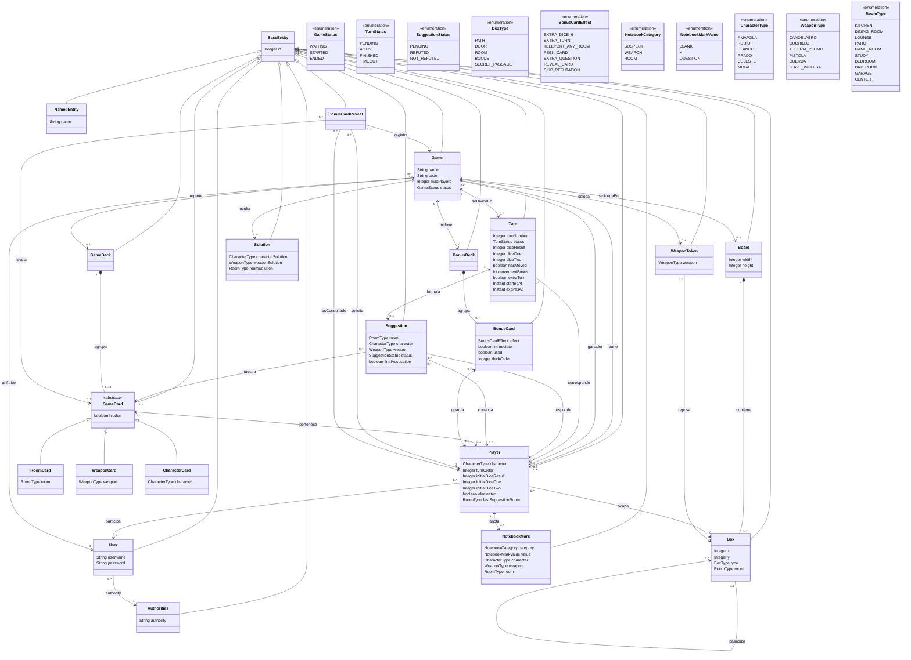

# Documento de diseño del sistema
**Asignatura:** Diseño y Pruebas (Grado en Ingeniería del Software, Universidad de Sevilla)  
**Curso académico:** 2026/2027<br>
**Grupo/Equipo:** L5-5<br>
**Nombre del proyecto:** Cluedo<br>
**Repositorio:** [<!-- URL del repo --> ](https://github.com/gii-is-DP1/dp1-2627-groupproject-L5-5<br>) 
**Integrantes (máx. 6):** <br>
Javier Bonilla Fernández - javbonfer@alum.us.es <br>
Amalio Romero López - amaromlop@alum.us.es <br>
David Calzado Villalba - davcalvill@alum.us.es <br>
Pedro Larios Soler - pedlarsol@alum.us.es <br>
Alfonso Perea Morillo - alfpermor@alum.us.es <br>
Nicolas Martinez Adega - nicmarade@alum.us.es

_Esta es una plantilla que sirve como guía para realizar este entregable. Por favor, mantén las mismas secciones y los contenidos que se indican para poder hacer su revisión más ágil._ 

## Introducción

El proyecto tiene como objetivo el diseño e implementación del juego de mesa Cluedo la versión de 2012 con todas sus normas adicionales en forma digital. La aplicación permite a los usuarios crear partidas, unirse a ellas y disfrutar de una partida completa al Cluedo, garantizando el cumplimiento de las normas establecidas por el sistema.

El valor principal que nos aporta es la posibilidad de aprender y poner en práctica diferentes patrones de diseño y arquitecturas actuales. Además, gracias a la automatización del juego nos podemos olvidar de aspectos repetitivos como el reparto de cartas en cada partida, o el simple hecho de garantizar que nadie incumpla las normas.

Buscamos con su desarrollo conseguir que se pueda jugar una partida completa de principio a fin de manera fluida. Si surge un error en el backend o en la red, evitaremos que la aplicación se congele y redirigiremos a los jugadores a una página de error que les permita regresar a la partida en curso sin perder su progreso.

Además ,utilizaremos una arquitectura independiente (Spring Boot en el backend y React en el frontend), aplicando patrones de diseño en las mecánicas del juego y asegurar con pruebas unitarias y de integración que todo lo que no sea trivial funcione sin fallos. 

Las partidas están diseñadas para albergar un mínimo de 2 y un máximo de 6 jugadores. Para el modo especial de 2 jugadores, el sistema gestionará automáticamente el reparto inicial dejando 4 cartas boca abajo en el tablero que nadie posee inicialmente. Con 2 jugadores las cartas especiales no estarán habilitadas.

Comenzará a jugar el jugador que mayor número saque tirando ambos dados. La partida discurre de forma secuencial por turnos. Un jugador lanza los dados y desplaza su ficha por el tablero intentando alcanzar una habitación o una casilla de carta especial. Al entrar en una habitación, formula una sugerencia combinando un personaje, un arma y la sala actual. El sistema cede el control al resto de jugadores, en sentido horario, para que intenten refutar la teoría mostrando en secreto una carta al jugador que presentó la sugerencia. Los usuarios interactúan constantemente con una libreta de investigación integrada para registrar sus deducciones.

El juego concluye en el momento en que un participante reúne las pistas suficientes y formula una acusación final. Para ello, el jugador selecciona el trío definitivo de culpable, arma y lugar. Si las tres cartas seleccionadas coinciden exactamente con las que se escondieron en el sobre confidencial al inicio, el sistema detiene el juego, nombre a ese jugador como ganador y lo anuncia por pantalla. Si la acusación es incorrecta, el jugador queda eliminado de la investigación, por lo que no podrá volver a mover su ficha ni formular sugerencias, aunque sus cartas seguirán activas y visibles para poder refutar las preguntas del resto de jugadores.


[Enlace al vídeo de explicación de las reglas del juego / partida jugada por el grupo](https://youtu.be/_M9rlGXBljc)

## Diagrama(s) UML:

### Diagrama de Dominio/Diseño

El diagrama traduce el modelo conceptual a las clases Java que persisten la partida. Cada atributo lleva el tipo del backend. Las restricciones simples del conceptual quedan en la nota de su clase. Controladores, servicios y repositorios no aparecen aquí: pertenecen al diagrama de capas.

`BaseEntity` es la clase base del marco y aporta `id: Integer`. `NamedEntity` también pertenece al marco y añade `name`, pero ninguna entidad de Cluedo la especializa: el nombre de la sala está en `Game`, con su propio tamaño. El atributo conceptual `authority` deja de ser un texto suelto y pasa a ser la entidad `Authorities`.

La flecha simple indica que solo el origen guarda la referencia. La flecha doble indica que las dos clases se referencian: el agregado guarda la colección y el elemento guarda el agregado. El rombo sin punta de flecha es una composición bidireccional. `Box` no existe sin `Board`, y las cartas no existen sin su mazo. La cardinalidad está en los dos extremos. El número junto a una clase es cuántas instancias de esa clase se enlazan con una instancia de la otra.

No hay clases validadoras propias. La obligatoriedad, el tamaño y los rangos se declaran con Jakarta Bean Validation sobre los atributos, y la unicidad con restricciones de JPA. Por eso el diagrama no incluye dependencias `<<validates>>`.

Dos ajustes respecto al conceptual, ya visibles en las clases. Las tres cartas del sobre no se persisten como `GameCard`: `Solution` guarda los tres enumerados y el mazo de pista queda con 18 cartas. El mazo bonus no se crea en partidas de dos jugadores. `BonusDeck` sigue siendo `0..1` porque durante la espera no existe y, con dos jugadores, tampoco se crea.

```mermaid
classDiagram
    BaseEntity <|-- NamedEntity
    BaseEntity <|-- User
    BaseEntity <|-- Authorities
    BaseEntity <|-- Game
    BaseEntity <|-- Player
    BaseEntity <|-- Board
    BaseEntity <|-- Box
    BaseEntity <|-- WeaponToken
    BaseEntity <|-- Turn
    BaseEntity <|-- Suggestion
    BaseEntity <|-- GameCard
    BaseEntity <|-- BonusCard
    BaseEntity <|-- GameDeck
    BaseEntity <|-- BonusDeck
    BaseEntity <|-- Solution
    BaseEntity <|-- NotebookMark
    BaseEntity <|-- BonusCardReveal

    GameCard <|-- RoomCard
    GameCard <|-- WeaponCard
    GameCard <|-- CharacterCard

    User "0..*" --> "1" Authorities : authority
    Player "0..*" --> "1" User : participa
    Game "0..*" --> "1" User : anfitrion
    Game "1" <--> "1..6" Player : reune
    Game "0..1" --> "0..1" Player : ganador

    Game "1" <--> "0..1" Board : seJuegaEn
    Board "1" *-- "1..*" Box : contiene
    Box "0..1" --> "0..1" Box : pasadizo
    Player "0..*" --> "0..1" Box : ocupa

    Game "1" <--> "0..6" WeaponToken : coloca
    WeaponToken "0..*" --> "0..1" Box : reposa

    Game "1" <--> "0..*" Turn : seDivideEn
    Turn "0..*" --> "1" Player : corresponde
    Turn "1" <--> "0..1" Suggestion : formula
    Suggestion "0..*" --> "0..1" Player : responde
    Suggestion "0..*" --> "0..1" Player : consulta
    Suggestion "0..*" --> "0..1" GameCard : muestra

    Game "1" <--> "0..1" GameDeck : reparte
    GameDeck "1" *-- "0..18" GameCard : agrupa
    GameCard "0..*" <--> "0..1" Player : pertenece

    Game "1" <--> "0..1" BonusDeck : incluye
    BonusDeck "1" *-- "0..*" BonusCard : agrupa
    BonusCard "0..*" <--> "0..1" Player : guarda

    Game "1" <--> "0..1" Solution : oculta
    Player "1" <--> "0..*" NotebookMark : anota

    BonusCardReveal "0..*" --> "1" Game : registra
    BonusCardReveal "0..*" --> "1" Player : solicita
    BonusCardReveal "0..*" --> "1" Player : esConsultado
    BonusCardReveal "0..*" --> "0..1" GameCard : revela

    class BaseEntity {
        Integer id
    }

    class NamedEntity {
        String name
    }

    class User {
        String username
        String password
    }

    class Authorities {
        String authority
    }

    class Game {
        String name
        String code
        Integer maxPlayers
        GameStatus status
    }

    class Player {
        CharacterType character
        Integer turnOrder
        Integer initialDiceResult
        Integer initialDiceOne
        Integer initialDiceTwo
        boolean eliminated
        RoomType lastSuggestionRoom
    }

    class Board {
        Integer width
        Integer height
    }

    class Box {
        Integer x
        Integer y
        BoxType type
        RoomType room
    }

    class WeaponToken {
        WeaponType weapon
    }

    class Turn {
        Integer turnNumber
        TurnStatus status
        Integer diceResult
        Integer diceOne
        Integer diceTwo
        boolean hasMoved
        int movementBonus
        boolean extraTurn
        Instant startedAt
        Instant expiresAt
    }

    class Suggestion {
        RoomType room
        CharacterType character
        WeaponType weapon
        SuggestionStatus status
        boolean finalAccusation
    }

    class GameDeck

    class GameCard {
        <<abstract>>
        boolean hidden
    }

    class RoomCard {
        RoomType room
    }

    class WeaponCard {
        WeaponType weapon
    }

    class CharacterCard {
        CharacterType character
    }

    class BonusDeck

    class BonusCard {
        BonusCardEffect effect
        boolean immediate
        boolean used
        Integer deckOrder
    }

    class Solution {
        CharacterType characterSolution
        WeaponType weaponSolution
        RoomType roomSolution
    }

    class NotebookMark {
        NotebookCategory category
        NotebookMarkValue value
        CharacterType character
        WeaponType weapon
        RoomType room
    }

    class BonusCardReveal

    class GameStatus {
        <<enumeration>>
        WAITING
        STARTED
        ENDED
    }

    class TurnStatus {
        <<enumeration>>
        PENDING
        ACTIVE
        FINISHED
        TIMEOUT
    }

    class SuggestionStatus {
        <<enumeration>>
        PENDING
        REFUTED
        NOT_REFUTED
    }

    class BoxType {
        <<enumeration>>
        PATH
        DOOR
        ROOM
        BONUS
        SECRET_PASSAGE
    }

    class BonusCardEffect {
        <<enumeration>>
        EXTRA_DICE_6
        EXTRA_TURN
        TELEPORT_ANY_ROOM
        PEEK_CARD
        EXTRA_QUESTION
        REVEAL_CARD
        SKIP_REFUTATION
    }

    class NotebookCategory {
        <<enumeration>>
        SUSPECT
        WEAPON
        ROOM
    }

    class NotebookMarkValue {
        <<enumeration>>
        BLANK
        X
        QUESTION
    }

    class CharacterType {
        <<enumeration>>
        AMAPOLA
        RUBIO
        BLANCO
        PRADO
        CELESTE
        MORA
    }

    class WeaponType {
        <<enumeration>>
        CANDELABRO
        CUCHILLO
        TUBERIA_PLOMO
        PISTOLA
        CUERDA
        LLAVE_INGLESA
    }

    class RoomType {
        <<enumeration>>
        KITCHEN
        DINING_ROOM
        LOUNGE
        PATIO
        GAME_ROOM
        STUDY
        BEDROOM
        BATHROOM
        GARAGE
        CENTER
    }

    note for BaseEntity "id obligatorio tras persistir. Lo genera la secuencia entity_sequence"
    note for NamedEntity "name longitud 3 a 50. Ninguna entidad de Cluedo extiende esta clase"
    note for User "username obligatorio y unico. password obligatoria. authority obligatorio: PLAYER o ADMIN"
    note for Authorities "authority obligatorio, unico y longitud maxima 20"
    note for Game "name obligatorio, longitud 3 a 40, no repetido entre partidas en WAITING. code obligatorio, unico, 6 caracteres A-Z o 0-9. maxPlayers obligatorio, minimo 2 y maximo 6. status obligatorio"
    note for Player "character obligatorio y unico en la partida. El mismo usuario no se repite en la partida. eliminated obligatorio. turnOrder, si existe, minimo 1. Los dados iniciales son opcionales"
    note for Board "width y height obligatorios, minimo 1. La mansion es 21 por 19. Se crea al iniciar"
    note for Box "x e y obligatorios, minimo 0 y unicos en el tablero. type obligatorio. room solo si la casilla pertenece a una habitacion. En pasillo o puerta solo cabe una ficha; en habitacion caben varias"
    note for WeaponToken "weapon obligatorio y unico en la partida. Al iniciar hay una ficha por arma, en su habitacion inicial"
    note for Turn "turnNumber obligatorio, minimo 1. status obligatorio. startedAt obligatorio. diceResult, si existe, minimo 0. hasMoved, movementBonus y extraTurn obligatorios. Como mucho una sugerencia por turno"
    note for Suggestion "room, character, weapon, status y finalAccusation obligatorios. room es la habitacion de la ficha. Quien responde y quien consulta son opcionales"
    note for GameDeck "Como mucho 18 cartas. Las 3 de la solucion no se guardan en el mazo"
    note for GameCard "hidden obligatorio. Sin propietario si es carta neutral o sobrante. En partidas de 2 se apartan 4 cartas ocultas sin propietario"
    note for RoomCard "room obligatorio. CENTER no es carta de habitacion"
    note for WeaponCard "weapon obligatorio"
    note for CharacterCard "character obligatorio"
    note for BonusDeck "Se crea al iniciar si hay mas de 2 jugadores. No existe durante la espera ni en el modo de dos"
    note for BonusCard "effect, immediate y used obligatorios. deckOrder registra el orden en el mazo. Sin jugador si sigue en el mazo o esta descartada"
    note for Solution "characterSolution, weaponSolution y roomSolution obligatorios. Una sola solucion por partida, creada al iniciar y oculta hasta la acusacion"
    note for NotebookMark "category y value obligatorios. Exactamente uno de character, weapon o room, segun category. Una sola marca por jugador y elemento"
    note for BonusCardReveal "La partida, quien solicita y quien es consultado son obligatorios. Quien solicita y quien es consultado son jugadores distintos. La carta revelada es opcional hasta resolverla"
    note for RoomType "CENTER no es carta de habitacion. Es la sala desde la que se acusa"
```



El mismo diagrama, sin las notas de restricciones:



### Diagrama de Capas (incluyendo Controladores, Servicios y Repositorios)

<br>

![Diagrama de capas](https://www.plantuml.com/plantuml/png/Z9N1Rjim38RlUGgXzm9xW29ObWnR3nk6fCCkkR0own1MI46YksN3tdtkah21qLYwMUBtamBu1NcV5PBs-p0B-AHEnILgT-eQIkYLX6Uv8uwGOEyY-0vQtEWXe7if0xS1Bu10Z7g8w2JfJYuAUGUD_2HktHE4V1dn0N9Ug2Pwx1NllV26VgDxDvkTfhcR9KHm3RgOC2ChU1BUyb9OamHePBY-SP3TwIPWokxFp1rRkqMlkzUAkxlpTfZFZVgUCQqnQvdy17ki8n_wn7Namli-Wv9Kyfk-RJ7Nyrz5yL6agwC_2FTv2QbPupD2g0qDWJAs6be6YPXocVtuosDK4luCt0obAma7pJDv789_tv0cI4l-_nTZAvvaonjCGu3aQCtnX6DbJjV3f7py6ibofMvvIQI4kTHcXGeKpjZzFeOnQj9TQMMgJTLDi0dAj9gWRDDJmB9GDx_Aa4auWPhTKymFX2Zy81to2Bjgpekab1NP4snvZL4ogQIpDwyNPtTigLOw34EI7TusP1AsvPUfRm4EXT6coZHbIwvxshAQNA7logHjlXOrIIe3TS_OIEYLX8ka-VS5Kg7loCGoRB_82NPmT_GVTtix_zTe7UD44WKn6CvzgfNsAf016VT7BH5OtrWgOlypNUtgPx_Ei2LNXCNk-pCoWYvLZqLsWALxiP3Ai528FDKmIzia_ffgiQiUgbCjzcLnX4r6MVABdMH9RKY_qQRHkpqUcWnArzKjxsnAJt32UTPT616cJ7O1w8rQDOcQsrAt5Wva3_Zw-I0IkKctzT2HSGS0Tv4r3usvMzJPUEhMeu7c2u1fmm4Pou9xU0bzMOIH579a6W2q3H3R1Wo8E3jGbYko3e2WTafiEoMsdJtSethb4D152PUXxeYAkf__wAzt7H4kEIAqmS4S_yCv0Db-_PRLFP6WOnsWdIX-6skjYXSgkGquM3yDiHs9rIuqZfT1qFaY8ho1q1wzp_DPOi8hDlwzVxrzVtxy0000)


_En este caso, como mermaid no soporta la definición de paquetes, hemos usado una [herramienta muy similar llamada plantUML}(https://www.plantuml.com/). Esta otra herramienta tiene un formulario para visualizar los diagramas previamente disponible en [https://www.plantuml.com/plantuml/uml/}(https://www.plantuml.com/plantuml/uml/). Lo que hemos hecho es preparar el diagrama en ese formulario, y una vez teníamos el diagrama lista, grabarlo en un fichero aparte dentro del propio repositorio, y enlazarlo con el formulario para que éste nos genera la imagen del diagrama usando una funcionalizad que nos permite especificar el código del diagrama a partir de una url. Por ejemplo, si accedes a esta url verás el editor con el código cargado a partir del fichero del repositorio original: [http://www.plantuml.com/plantuml/proxy?cache=no&src=https://raw.githubusercontent.com/gii-is-DP1/group-project-seed/main/docs/diagrams/LayersUMLPackageDiagram.iuml](http://www.plantuml.com/plantuml/proxy?cache=no&src=https://raw.githubusercontent.com/gii-is-DP1/group-project-seed/main/docs/diagrams/LayersUMLPackageDiagram.iuml)._

## Descomposición del mockups del tablero de juego en componentes

En esta sección procesaremos el mockup del tablero de juego (o los mockups si el tablero cambia en las distintas fases del juego). Etiquetaremos las zonas de cada una de las pantallas para identificar componentes a implementar. Para cada mockup se especificará el árbol de jerarquía de componentes, así como, para cada componente el estado que necesita mantener, las llamadas a la API que debe realizar y los parámetros de configuración global que consideramos que necesita usar cada componente concreto. 
Por ejemplo, para la pantalla de visualización de métricas del usuario en un hipotético módulo de juego social:


  - App – Componente principal de la aplicación
    - $\color{orange}{\textsf{NavBar – Barra de navegación lateral}}$
      - $\color{darkred}{\textsf{[ NavButton ]. Muestra un botón de navegación con un icono asociado.}}$
    - $\color{darkblue}{\textsf{UserNotificationArea – Área de notificaciones e identificación del usuario actual}}$
    - $\color{blue}{\textsf{MetricsBar – En este componente se muestran las métricas principales del juego. Se mostrarán 4 métricas: partidas jugadas, puntos logrados, tiempo total, y cartas jugadas.}}$
      - $\color{darkgreen}{\textsf{[ MetricWell ] – Proporciona el valor y el incremento semanal de una métrica concreta. }}$
    - $\color{purple}{\textsf{GamesEvolutionChart – Muestra la tendencia de evolución en ellos últimos 4 meses en cuanto a partida jugadas, ganadas, perdidas y abandonadas.}}$
    - $\color{yellow}{\textsf{PopularCardsChart – Muestra la proporción de las N (parámetro de configuración) cartas más jugadas en el juego por el jugador.}}$
    - $\color{red}{\textsf{FrequentCoPlayersTable – Muestra los jugadores  con los que más se  ha jugado (de M en M donde M es un parámetro definido por la configuración del componente). Concretamente, se mostrarán la el nombre, la fecha de la última partida, la localización del jugador el porcentaje de partidas jugadas por ambos en las que el usuario ha ganado y si el jugador es amigo o no del usuario.}}$

## Patrones de diseño y arquitectónicos aplicados
En esta sección de especificar el conjunto de patrones de diseño y arquitectónicos aplicados durante el proyecto. Para especificar la aplicación de cada patrón puede usar la siguiente plantilla:

### Patrón: < Nombre del patrón >
*Tipo*: Arquitectónico | de Diseño

*Contexto de Aplicación*

Describir las partes de la aplicación donde se ha aplicado el patrón. Si se considera oportuno especificar el paquete donde se han incluido los elementos asociados a la aplicación del patrón.

*Clases o paquetes creados*

Indicar las clases o paquetes creados como resultado de la aplicación del patrón.

*Ventajas alcanzadas al aplicar el patrón*

Describir porqué era interesante aplicar el patrón.

## Decisiones de diseño
_Decisiones de diseño observables en la implementación actual._

### Decisión 1: Persistencia del estado de partida
#### Descripción del problema:

El estado de una partida debe mantenerse entre peticiones y compartirse entre jugadores, incluyendo turnos, tiradas, movimientos y tiempos.

#### Alternativas de solución evaluadas:

*Alternativa 1.a*: Mantener el estado solo en memoria, con riesgo de perderlo al reiniciar y sin una fuente compartida persistente.

*Alternativa 1.b*: Persistir Game, Player y Turn como entidades relacionadas en la base de datos.

#### Justificación de la solución adoptada

Se adopta la segunda alternativa. Game, Player, Board, las cartas y Turn se persisten mediante JPA, de forma que el estado relevante de una partida se comparte entre peticiones y jugadores. Turn almacena el jugador, estado, número, dados, movimiento y fechas de inicio y expiración. TurnService modifica estos datos en transacciones y un proceso programado finaliza los turnos vencidos. Así el servidor conserva la autoridad sobre el estado de juego y puede recuperar una partida después de una recarga del cliente.

### Decisión 2: Protección de cartas y solución secreta
#### Descripción del problema:

El estado compartido debe permitir representar la partida sin exponer la solución del sobre ni las cartas de los demás jugadores.

#### Alternativas de solución evaluadas:

*Alternativa 2.a*: Enviar todas las relaciones del juego y ocultar información en React, lo que dejaría los secretos accesibles en la respuesta.

*Alternativa 2.b*: Filtrar los datos en el servidor según el jugador autenticado.

#### Justificación de la solución adoptada

Se adopta la segunda alternativa. Solution mantiene los valores de la combinación secreta separados de las cartas repartibles y las relaciones sensibles usan `@JsonIgnore`. Además, `GameService` obtiene al usuario autenticado, consulta únicamente su mano y construye `GameStateResponse` con `myHand` del jugador actual y las cartas públicas. La privacidad se garantiza en el servidor y en la respuesta de la API, no solo ocultando elementos en React.

### Decisión 3: Reglas de reparto para dos jugadores
#### Descripción del problema:

La variante de dos jugadores reserva cuatro cartas neutrales y no usa las cartas especiales. Hay que distinguir ese reparto del de las partidas con más jugadores, en las que sí existe el mazo bonus.

#### Alternativas de solución evaluadas:

*Alternativa 3.a*: Aplicar el mismo reparto y mazos a todas las partidas.

*Alternativa 3.b*: Adaptar el reparto y los mazos al número de participantes al iniciar.

#### Justificación de la solución adoptada

Se adopta la segunda alternativa en `CardService`. Para dos jugadores se apartan cuatro cartas sin propietario, marcadas como ocultas, y se reparten las catorce restantes. En ese modo no se crea el mazo bonus ni se roba carta al caer en una casilla bonus. Con más jugadores el reparto es equitativo, las cartas sobrantes quedan sin propietario y se muestran como cartas públicas, y el mazo bonus se crea al iniciar y se roba al finalizar el movimiento en una casilla bonus. Las cartas neutrales no se incluyen en `faceUpCards`; si una acusación incorrecta contiene alguna de ellas, el backend devuelve esas cartas únicamente en la respuesta privada de la acusación para que el jugador pueda consultarlas.

Cuando la partida tiene más de dos jugadores, el mazo bonus contiene una carta de cada uno de los seis efectos y se baraja al iniciar la partida. «Muévete a cualquier habitación», «Pregunta extra» y «Haz que alguien revele una carta» se resuelven inmediatamente; la pregunta extra no mueve fichas y la carta revelada se muestra a todos. «Echa un vistazo», «Suma 6» y «Turno extra» se guardan en la mano hasta que se puedan usar. «Suma 6» aumenta en seis la tirada actual si el jugador todavía no se ha movido; si ya terminó su movimiento, habilita un movimiento adicional de hasta seis casillas en ese mismo turno. Al jugar «Turno extra», el sistema avanza automáticamente al nuevo turno del mismo jugador. El servidor valida y consume cada carta al aplicar su efecto.

### Decisión 4: Tablero representado por casillas persistentes
#### Descripción del problema:

Las reglas necesitan validar posiciones, ocupación, movimiento y pasadizos, y la interfaz debe dibujar esas mismas posiciones.

#### Alternativas de solución evaluadas:

*Alternativa 4.a*: Modelar el tablero solo como imagen o estructura fija del cliente, insuficiente para validar y persistir movimientos.

*Alternativa 4.b*: Persistir un Board por partida, compuesto por Box con coordenadas, tipo y enlaces a pasadizos.

#### Justificación de la solución adoptada

Se adopta la segunda alternativa. Board y Box son entidades; las coordenadas y el tipo de cada Box forman la representación persistente del tablero. BoardService calcula destinos alcanzables, valida los movimientos y gestiona los pasadizos secretos. React representa la cuadrícula, los jugadores y las armas a partir del estado recibido, pero la regla de movimiento no depende de la interfaz.

### Decisión 5: Validación de acciones en el servidor
#### Descripción del problema:

Las acciones dependen del jugador activo y del estado y tiempo del turno; la interfaz por sí sola no puede impedir peticiones inválidas.

#### Alternativas de solución evaluadas:

*Alternativa 5.a*: Validar solo en React, con una experiencia visual directa, pero vulnerable a llamadas manuales a la API.

*Alternativa 5.b*: Validar en los servicios del backend y reflejar en React los errores resultantes.

#### Justificación de la solución adoptada

Se adopta la segunda alternativa. `TurnService` comprueba que el turno esté activo, corresponda al usuario autenticado y no haya expirado; las operaciones aplican sus propias precondiciones y `advanceTurn` excluye jugadores eliminados. La acusación reutiliza estas validaciones, exige que el jugador esté en la casilla central y finaliza la partida si coincide con la solución. React deshabilita acciones no disponibles, pero el servidor vuelve a validar cada petición y comunica los errores mediante respuestas HTTP manejadas por la interfaz.

### Decisión 6: Sincronización mediante consulta periódica
#### Descripción del problema:

Los clientes necesitan conocer los cambios de estado realizados por otros participantes.

#### Alternativas de solución evaluadas:

*Alternativa 6.a*: Actualizar solo tras las acciones locales, dejando desactualizados a los demás clientes.

*Alternativa 6.b*: Consultar periódicamente el endpoint REST, con peticiones aunque no haya cambios.

*Alternativa 6.c*: Usar WebSocket, con menor sondeo pero más infraestructura.

#### Justificación de la solución adoptada

GamePlay adopta la alternativa 6.b: consulta /games/{code} cada dos segundos y actualiza el estado React. Esta es la sincronización implementada actualmente; las notificaciones WebSocket descritas en los requisitos no están implementadas.

### Decisión 7: Separación por capas y transacciones de aplicación
#### Descripción del problema:

El sistema debe separar la exposición HTTP, las reglas de negocio y el acceso a datos para evitar que los controladores gestionen directamente la persistencia o las reglas del juego.

#### Alternativas de solución evaluadas:

*Alternativa 7.a*: Implementar la lógica directamente en los controladores y acceder desde ellos a los repositorios.

*Alternativa 7.b*: Separar la aplicación en controladores REST, servicios de negocio y repositorios JPA, usando servicios transaccionales para las operaciones que modifican el estado.

#### Justificación de la solución adoptada

Se adopta la segunda alternativa. Los controladores reciben las peticiones y delegan en servicios como `GameService`, `TurnService`, `BoardService` y `CardService`; los servicios aplican las reglas y utilizan repositorios para persistir entidades. Las operaciones que cambian el estado se marcan como transaccionales, de modo que una acción del juego se confirma completa o se revierte ante un error. Esta separación facilita las pruebas unitarias y de integración y mantiene una única autoridad para las reglas.

### Decisión 8: Gestión de fallos de conexión y errores de dominio
#### Descripción del problema:

Las peticiones pueden fallar por pérdida de conexión, partida inexistente, permisos insuficientes o acciones no válidas. La interfaz debe informar del problema sin mostrar un estado de partida incorrecto.

#### Alternativas de solución evaluadas:

*Alternativa 8.a*: Ignorar los errores y conservar indefinidamente el último estado mostrado.

*Alternativa 8.b*: Propagar errores explícitos desde el backend y mostrar un estado de error o un mensaje contextual en React.

#### Justificación de la solución adoptada

Se adopta la segunda alternativa. El backend usa excepciones de dominio para rechazar partidas inexistentes, accesos no autorizados y acciones incompatibles con el turno. El frontend interpreta el mensaje de la respuesta, muestra el error al usuario y, si todavía no dispone del estado de la partida, ofrece volver a una pantalla segura en lugar de presentar una partida ficticia. Durante la actualización periódica conserva el estado cargado, pero informa del fallo para que el usuario conozca que la información puede no estar actualizada.

### Decisión 9: Persistencia de las marcas de la libreta
#### Descripción del problema:

Cada jugador necesita conservar sus deducciones al cerrar y volver a abrir la partida, también desde otro navegador. Las marcas son privadas y no forman parte de las reglas compartidas ni del estado que consultan los demás participantes.

#### Alternativas de solución evaluadas:

*Alternativa 9.a*: Guardar las marcas únicamente en el estado React, perdiéndolas al recargar la página.

*Alternativa 9.b*: Persistirlas en el backend, asociadas al jugador de la partida, y consultarlas con el usuario autenticado.

*Alternativa 9.c*: Guardarlas en el almacenamiento local del navegador, aisladas por código de partida y usuario. Sobreviven a una recarga en ese navegador, pero no se recuperan en otro dispositivo ni si se borra el almacenamiento.

#### Justificación de la solución adoptada

Se adopta la segunda alternativa. Al iniciar la partida, `NotebookService.initializeForGame` crea una `NotebookMark` en blanco por jugador y por sospechoso, arma y habitación de carta. `InvestigationNotebook` pide las marcas del jugador autenticado con `GET /games/{code}/notebook/marks` y guarda cada cambio con `PUT /games/{code}/notebook/marks/{id}`. El servicio resuelve la partida y el jugador a partir del usuario autenticado, y solo actualiza una marca si pertenece a ese jugador. Las marcas quedan fuera del estado común de la partida. Las cartas que el jugador tiene en la mano se muestran tachadas en la libreta y no se pueden cambiar desde ella.

## Refactorizaciones aplicadas

### Refactorización 1: Agrupar las salas del tablero en un módulo propio
#### Estado inicial del código
`Board.jsx` construía cada casilla con su identificador, sus coordenadas y su textura. La casilla no sabía a qué habitación pertenecía, así que el tablero no podía tratar como una sola sala las casillas de un mismo cuarto:

```javascript
const sequentialId = y * cols + x + 1;
const texture = textureMap.get(String(sequentialId)) || textureMap.get(`${x},${y}`);
```

#### Estado del código refactorizado
Los rangos de cada habitación y las casillas que no se pueden pisar están en `boardRooms.js`. `getGroupNameByCellId` recorre esos rangos y devuelve la sala de un identificador. `Board` asigna esa sala al construir la casilla, y `GamePlay` usa el mismo conjunto de casillas bloqueadas al calcular el recorrido de la animación:

```javascript
export function getGroupNameByCellId(cellId) {
    const numId = Number(cellId);
    for (const [groupName, definitions] of Object.entries(CELL_GROUPS_MAP)) {
        for (const item of definitions) {
            if (Array.isArray(item)) {
                const [start, end] = item;
                if (numId >= start && numId <= end) {
                    return groupName;
                }
            }
        }
    }
    return null;
}
```

```javascript
const group = getGroupNameByCellId(sequentialId);
```

#### Problema que nos hizo realizar la refactorización
Los rangos de las habitaciones son un dato del tablero, y tanto el dibujo como la animación del movimiento los necesitan. Dejarlos dentro de `Board.jsx` mezclaba ese mapa con el código que pinta las casillas, y obligaba a copiarlo en `GamePlay` para no atravesar muros.

#### Ventajas que presenta la nueva versión del código respecto de la versión original
El mapa de salas tiene un solo sitio. `Board` pinta y resalta la habitación completa porque cada casilla lleva su sala, y `GamePlay` consulta `UNCLICKABLE_CELL_IDS` desde el mismo módulo. Cambiar las casillas de una habitación no exige buscarlas dentro del componente que dibuja el tablero. El movimiento válido lo sigue decidiendo el servidor con `BoardLayout`.

### Refactorización 2: Centralizar la comprobación de cartas que refutan una sugerencia
#### Estado inicial del código
La misma comprobación del tipo y valor de una carta se repetía en `CardService` y `SuggestionService`:
```java
boolean matches = (card instanceof CharacterCard characterCard
        && characterCard.getCharacter() == suggestion.getCharacter())
        || (card instanceof WeaponCard weaponCard && weaponCard.getWeapon() == suggestion.getWeapon())
        || (card instanceof RoomCard roomCard && roomCard.getRoom() == suggestion.getRoom());
```

#### Estado del código refactorizado
La regla se implementa una vez en `CardService.matchesSuggestion` y se reutiliza al filtrar las cartas del jugador, las cartas neutrales y al validar la carta elegida:
```java
public boolean matchesSuggestion(GameCard card, CharacterType character, WeaponType weapon, RoomType room) {
    return (card instanceof CharacterCard characterCard && characterCard.getCharacter() == character)
            || (card instanceof WeaponCard weaponCard && weaponCard.getWeapon() == weapon)
            || (card instanceof RoomCard roomCard && roomCard.getRoom() == room);
}
```
#### Problema que nos hizo realizar la refactorización
La regla estaba duplicada, por lo que un cambio podía hacer que la selección de cartas y la validación del servidor aplicaran criterios distintos.
#### Ventajas que presenta la nueva versión del código respecto de la versión original
La regla tiene una única implementación y se reutiliza en los tres puntos. Se mantiene el comportamiento: una carta refuta si coincide con el sospechoso, el arma o la habitación. Las pruebas de servicio comprueban los tres tipos de coincidencia y el rechazo de una carta que no coincide.

### Refactorización 3: Separar el modal de cartas bonus de la pantalla de partida
#### Estado inicial del código
Cuando un jugador caía en una casilla bonus, `GamePlay.jsx` mostraba una ventana con la carta y dos opciones: jugarla o esperar. Al principio, el código que dibujaba toda esa ventana estaba mezclado con el resto de la pantalla de partida, que también gestiona los turnos, el tablero y otras acciones.

#### Estado del código refactorizado
La ventana se trasladó a un componente propio, `BonusCardEventModal.jsx`. Cuando hay una carta bonus que mostrar, `GamePlay.jsx` le pasa los datos de esa carta y las acciones que se ejecutan al pulsar «Jugar carta» o «Esperar». El componente se ocupa de mostrar la ventana; la pantalla de partida sigue decidiendo qué debe ocurrir en respuesta a cada botón.

#### Problema que nos hizo realizar la refactorización
La ventana bonus tenía bastante contenido visual dentro de un componente que ya reunía muchas responsabilidades. Si queríamos retocar su apariencia, era necesario buscar ese bloque entre el código del resto de la partida.

#### Ventajas que presenta la nueva versión del código respecto de la versión original
Ahora la ventana tiene un lugar claro y separado, por lo que es más sencillo localizarla y modificar su presentación sin mezclar esos cambios con el tablero o la gestión de turnos. El comportamiento se mantiene: la carta se muestra igual y los botones siguen ejecutando las mismas acciones. No se modificaron las reglas para robar o usar cartas ni el movimiento de los jugadores.

### Refactorización 4: Separar la pantalla de partida en componentes
#### Estado inicial del código
`GamePlay.jsx` reunía en un solo componente la carga de la partida, las peticiones y todo el dibujo: la barra superior, los dados, el pasadizo, la hipótesis, la refutación, los avisos de cartas, la lista de jugadores y la mano. El cálculo del recorrido de la animación también estaba escrito dentro de ese mismo fichero.

#### Estado del código refactorizado
`GamePlay.jsx` se queda como coordinador. Carga la partida, guarda el estado y hace las peticiones. Cada zona visible pasó a su propio componente, que solo dibuja lo que recibe y avisa cuando el jugador pulsa un botón:

- `findPath.js` calcula el recorrido de la animación, sin dibujar ni llamar a la API.
- `GamePlayTopBar.jsx` muestra el nombre de la sala, el código, de quién es el turno y el tiempo restante.
- `TurnActions.jsx` muestra la tirada inicial, los dados del turno, el pasadizo secreto y el botón de terminar turno.
- `SuggestionPanel.jsx` muestra el formulario de hipótesis, la refutación y el resultado.
- `BonusRevealNotice.jsx` pide revelar una carta y lista las que ya se han mostrado a todos.
- `SolutionNotice.jsx` muestra el aviso del sobre confidencial.
- `PlayersPanel.jsx` lista a los jugadores y marca quién tiene el turno.
- `PlayerHand.jsx` muestra la mano, las cartas bonus y las que están boca arriba.

La comparación de una carta con la hipótesis, que estaba escrita dentro de la pantalla, pasó a `cardMatchesSuggestion` en `gameConstants.js`. `Board`, `InvestigationNotebook` y `BonusCardEventModal` siguen como estaban.

#### Problema que nos hizo realizar la refactorización
La pantalla de partida mezclaba la lógica de la partida con varias zonas de la interfaz. Cualquier cambio visual obligaba a buscarlo entre las peticiones, el temporizador y el movimiento.

#### Ventajas que presenta la nueva versión del código respecto de la versión original
Cada zona tiene un fichero propio y se puede modificar sin tocar el resto. Las llamadas a la API siguen en un solo sitio, así que las reglas de cuándo se puede actuar no se han repartido entre los componentes. La partida se ve y se juega igual que antes.

### Refactorización 5: Sacar del controlador la búsqueda de la partida y del jugador
#### Estado inicial del código
`BoardController` recibía `GameRepository` y consultaba la base de datos antes de llamar al servicio. También resolvía qué jugador autenticado participaba en la partida:

```java
public BoardController(BoardService boardService, GameRepository gameRepository, UserService userService) {
    this.boardService = boardService;
    this.gameRepository = gameRepository;
    this.userService = userService;
}

private Game findGameByIdOrCode(String gameId) {
    Integer id = Integer.parseInt(gameId);
    return gameRepository.findById(id)
            .orElseGet(() -> gameRepository.findByCode(gameId)
                    .orElseThrow(() -> new IllegalArgumentException("Partida no encontrada con id/código: " + gameId)));
}
```

Los endpoints de casillas alcanzables y de movimiento usaban esos métodos y solo entonces delegaban en `boardService.getReachableBoxes(player, diceRoll)` y `boardService.movePlayer(player, targetBoxId, diceRoll)`.

#### Estado del código refactorizado
El controlador solo depende de `BoardService`. Recibe el identificador de la partida y la tirada, y traduce el resultado a la respuesta HTTP:

```java
public ResponseEntity<List<ReachableBoxDto>> getReachable(
        @PathVariable String gameId,
        @RequestParam int diceRoll) {
    List<Box> boxes = boardService.getReachableBoxes(gameId, diceRoll);
    List<ReachableBoxDto> dtoList = boxes.stream()
            .map(b -> new ReachableBoxDto(b.getId(), b.getX(), b.getY(), b.getType(), b.getRoom()))
            .toList();
    return ResponseEntity.ok(dtoList);
}
```

La búsqueda de la partida, por id o por código, y la del jugador autenticado están en `BoardService`. El servicio ya puede usar el repositorio, porque la capa de negocio depende de la de persistencia:

```java
public List<Box> getReachableBoxes(String gameId, int diceRoll) {
    Game game = findGameByIdOrCode(gameId);
    Player player = findCurrentPlayerInGame(game);
    return getReachableBoxes(player, diceRoll);
}
```

`movePlayer(String gameId, Integer targetBoxId, int diceRoll)` hace el mismo paso previo y después aplica el movimiento que ya existía. `TurnService` sigue llamando a las versiones que reciben un `Player`.

#### Problema que nos hizo realizar la refactorización
La capa de presentación dependía directamente de la de persistencia y se saltaba la de negocio. El controlador decidía qué partida y qué jugador intervenían en el movimiento, además de construir la respuesta HTTP. Esa mezcla es una transgresión de capas: un controlador solo debe delegar en servicios.

#### Ventajas que presenta la nueva versión del código respecto de la versión original
`BoardController` queda limitado a la petición y a la respuesta. La regla de quién puede moverse está junto al resto de reglas del tablero, así que se puede probar sin levantar la capa HTTP. Los endpoints, los códigos de estado y los datos devueltos se mantienen. `BoardControllerTests` sigue comprobando el 200 y el 400, y `BoardServiceTests` comprueba la resolución por id o por código, la partida inexistente y el usuario que no participa.
